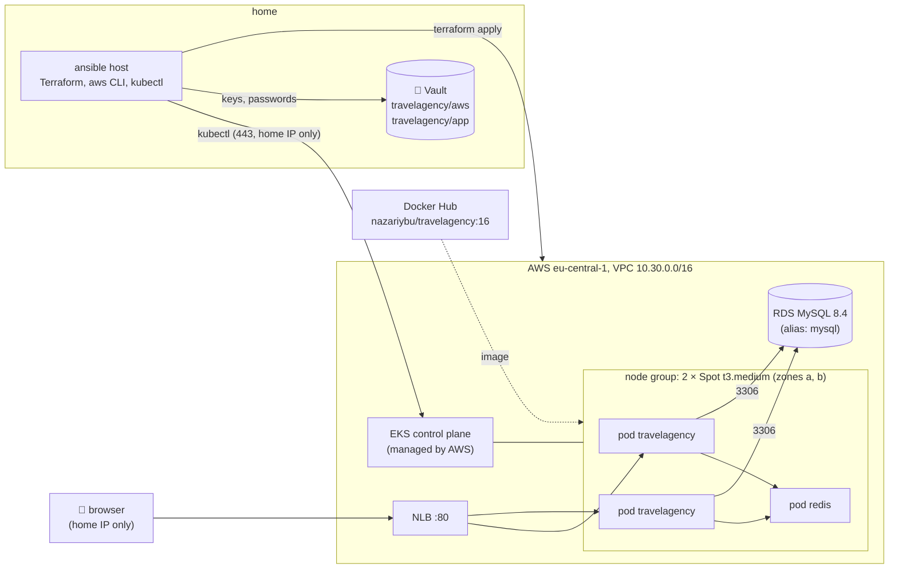

# Kubernetes: TravelAgency on Amazon EKS

The same Docker image that Jenkins pushes to Docker Hub (`nazariybu/travelagency:16`) now runs in
**Kubernetes**, on **Amazon EKS** (AWS runs the control plane, we add two worker nodes).
Everything in AWS is created by **Terraform** (`terraform/envs/eks`, own state); the app is described by plain
Kubernetes manifests in `k8s/`. Secrets come from **Vault**. The cluster is created for a session and
**destroyed after it** (~0.21 USD per hour).

| What | Where | Made by |
|------|-------|---------|
| VPC 10.30.0.0/16, 2 public + 2 DB subnets, no NAT | eu-central-1 a/b | Terraform `network.tf` |
| EKS control plane, Kubernetes 1.36, API only from the home IP | AWS (managed) | Terraform `eks.tf` |
| 2 worker nodes, Spot `t3.medium`-class, Amazon Linux 2023 | managed node group | Terraform `eks.tf` |
| metrics-server (for `kubectl top` and the HPA) | EKS community add-on | Terraform `eks.tf` |
| MySQL 8.4 | RDS `db.t4g.micro`, private | Terraform `database.tf` (password from Vault, write-only) |
| `mysql` alias of RDS + public NLB Service | `k8s/05-aws-generated.yaml` | Terraform writes it (not in Git) |
| Redis (sessions) | pod in the cluster | `k8s/15-redis.yaml` |
| App: Deployment (2–4 pods), PDB, HPA | namespace `travelagency` | `kubectl apply -f k8s/` |
| DB / Redis passwords for the pods | Secret `travelagency-secrets` | `kubectl create secret` with values from Vault |



## Folders

```
terraform/envs/eks/
├── versions.tf, providers.tf   # AWS key and DB password from Vault (ephemeral), default tags
├── variables.tf, terraform.tfvars
├── network.tf                  # VPC, subnets (tag kubernetes.io/role/elb), internet gateway
├── iam.tf                      # roles travelagency-eks-cluster, travelagency-eks-nodes
├── eks.tf                      # cluster (access entries, upgrade policy STANDARD), node group, metrics-server
├── security.tf                 # home IP, RDS security group (3306 from the cluster only)
├── database.tf                 # RDS MySQL 8.4
├── k8s-generated.tf            # writes k8s/05-aws-generated.yaml from k8s-aws.yaml.tftpl
├── outputs.tf
├── aws-env.sh                  # "source" it: AWS key from Vault for the aws CLI / kubectl, only in memory
└── terraform-user-policy.json  # extra IAM rights for the user terraform-travelagency (EKS + its roles)
k8s/
├── 00-namespace.yaml
├── 05-aws-generated.yaml       # written by Terraform, NOT in Git: Service mysql (ExternalName), Service travelagency (NLB)
├── 10-configmap.yaml           # DB URL (mysql:3306), Redis host, JVM options
├── 15-redis.yaml               # Redis Deployment + Service
├── 20-deployment.yaml          # the app: probes, resources, non-root, spread over nodes
├── 50-pdb.yaml
└── 60-hpa.yaml                 # 2..4 pods by CPU
```

## Run

On the ansible host (needs `terraform` >= 1.11, `vault`, `aws` CLI v2, `kubectl` 1.36; Vault unsealed):

```bash
vault login -method=userpass username=nazariy

# 1. AWS (~20 min)
cd terraform/envs/eks
terraform init
terraform plan                       # Plan: 22 to add
terraform apply

# 2. kubectl
source ./aws-env.sh                  # AWS key from Vault, only in this terminal
aws eks update-kubeconfig --region eu-central-1 --name travelagency
kubectl get nodes                    # 2 nodes Ready

# 3. the app
cd ../../..
kubectl apply -f k8s/00-namespace.yaml
kubectl -n travelagency create secret generic travelagency-secrets \
  --from-literal=DB_TRAVELAGENCY_PASSWORD="$(vault kv get -mount=secret -field=db_password travelagency/app)" \
  --from-literal=REDIS_TRAVELAGENCY_PASSWORD="$(vault kv get -mount=secret -field=redis_password travelagency/app)" \
  --dry-run=client -o yaml | kubectl apply -f -
kubectl apply -f k8s/
kubectl -n travelagency get svc travelagency     # EXTERNAL-IP = the NLB address, open http://<it>/
```

## Destroy (after every session!)

```bash
kubectl delete -f k8s/               # FIRST: deletes the NLB (Kubernetes made it, Terraform does not know it)
cd terraform/envs/eks
terraform destroy                    # Destroy complete! Resources: 22 destroyed.
```

Then check the console: EC2 → Load Balancers is empty, Resource Groups → Tag Editor → `Project = travelagency` finds nothing.

## Cost (eu-central-1, about)

| Resource | USD per hour |
|----------|--------------|
| EKS control plane | 0.10 |
| 2 × Spot t3.medium (+ disks) | ~0.04 |
| Public IPv4: 2 nodes + 2 NLB | 0.02 |
| NLB | ~0.03 |
| RDS db.t4g.micro + 20 GB | ~0.02 |
| **Total** | **~0.21** (~5 USD per day: destroy after the session) |

Details, choices and results: [REPORT.md](REPORT.md).