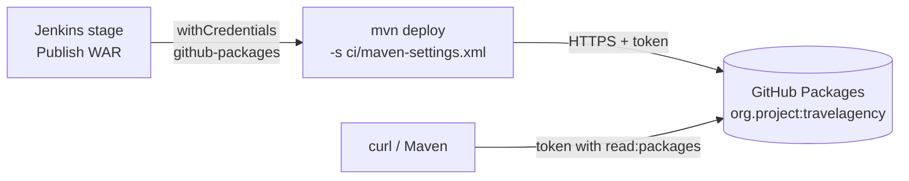

# Travel Agency: WAR artifact in GitHub Packages


Jenkins publishes the WAR of every build to **GitHub Packages**, the Maven
registry of this repo. Before this, `TravelAgency.war` was kept only in the
Jenkins build artifacts (`archiveArtifacts`).

Package: `org.project:travelagency`, version `1.0.<Jenkins build number>`.
Registry: `https://maven.pkg.github.com/nazariybu/travelagency`.

## How it works



`mvn deploy` needs two things:

| What | Where | Content |
|---|---|---|
| **Where** to upload | `pom.xml` → `<distributionManagement>` | URL of the registry, id `github` |
| **Who** uploads | `ci/maven-settings.xml` → `<server>` | the same id `github`, login and token from env vars |

Maven links the two files by the id `github`.

## Files

| File | Purpose |
|---|---|
| `pom.xml` | `distributionManagement` with the GitHub Packages URL; `artifactId` is `travelagency` |
| `ci/maven-settings.xml` | Login for the server `github`: `${env.GH_PKG_USER}` / `${env.GH_PKG_TOKEN}` (no secrets in Git) |
| `Jenkinsfile` | Stage `Publish WAR to GitHub Packages` |

## Setup

### 1. GitHub token

GitHub → **Settings → Developer settings → Personal access tokens → Tokens (classic)**
→ **Generate new token (classic)**, scope **`write:packages`** (GitHub adds
`read:packages` and `repo`). It must be a **classic** token: the GitHub Maven
registry does not accept fine-grained tokens.

### 2. Jenkins credential

**Manage Jenkins → Credentials → System → Global credentials → Add Credentials**

| Field | Value |
|---|---|
| Kind | Username with password |
| Username | `nazariybu` |
| Password | the `ghp_...` token |
| ID | `github-packages` |

### 3. Jenkins stage

```groovy
stage('Publish WAR to GitHub Packages') {
    when { branch 'github-packages' }
    agent {
        docker {
            image 'maven:3.9-eclipse-temurin-17'
            args  '-v /home/jenkins/.m2:/home/jenkins/.m2'
            reuseNode true
        }
    }
    steps {
        withCredentials([usernamePassword(credentialsId: 'github-packages',
                                          usernameVariable: 'GH_PKG_USER',
                                          passwordVariable: 'GH_PKG_TOKEN')]) {
            sh '''
                MVN="mvn -B -s ci/maven-settings.xml -Dmaven.repo.local=/home/jenkins/.m2/repository"
                $MVN versions:set -DnewVersion=1.0.$BUILD_NUMBER -DgenerateBackupPoms=false
                $MVN deploy -DskipTests
            '''
        }
    }
}
```

- `withCredentials` puts the login and token into `GH_PKG_USER` / `GH_PKG_TOKEN`
  only for this block; the token is masked as `****` in the log.
- `versions:set` gives every build its own version: GitHub Packages does not
  accept the same release version twice (`409 Conflict`). The change is only in
  the Jenkins workspace, not in Git.
- `-DskipTests`: the tests already ran in `Build & Test`.

## Publish by hand

From the repo root, Maven runs in Docker:

```bash
export GH_PKG_USER=nazariybu
export GH_PKG_TOKEN=ghp_...
docker run --rm -v "$PWD":/src -w /src -e GH_PKG_USER -e GH_PKG_TOKEN \
  maven:3.9-eclipse-temurin-17 \
  mvn -B -s ci/maven-settings.xml deploy -DskipTests
```

The version in `pom.xml` is `1.0-SNAPSHOT`; a snapshot can be uploaded many times.

## Check

```bash
# 1. Token works and has write:packages
curl -sI -u $GH_PKG_USER:$GH_PKG_TOKEN https://api.github.com/user | grep -iE '^(HTTP|x-oauth-scopes)'

# 2. Published versions
curl -s -u $GH_PKG_USER:$GH_PKG_TOKEN \
  https://maven.pkg.github.com/nazariybu/travelagency/org/project/travelagency/maven-metadata.xml

# 3. Download the WAR of build N
N=42
curl -fL -u $GH_PKG_USER:$GH_PKG_TOKEN -o test.war \
  https://maven.pkg.github.com/nazariybu/travelagency/org/project/travelagency/1.0.$N/travelagency-1.0.$N.war
unzip -l test.war | grep WEB-INF | head -3
```

- Jenkins log of the stage: `Uploaded to github: .../travelagency/1.0.<N>/travelagency-1.0.<N>.war`, `BUILD SUCCESS`.
- GitHub UI: repo page → **Packages** → `org.project.travelagency`.
- The next build adds version `1.0.<N+1>`, with no `409`.

## Troubleshooting

| Error | Meaning | Fix |
|---|---|---|
| `401 Unauthorized` | Login or token is wrong | Check the env vars, the credential ID `github-packages`, and that the token is classic |
| `403 Forbidden` | Token has no rights to write packages | New token with `write:packages` |
| `409 Conflict` | This version already exists | `versions:set` must run before `deploy` |
| `422 Unprocessable Entity` | GitHub does not accept the package | `artifactId` must be lower case (`travelagency`); check the URL `nazariybu/travelagency` |
| Stage is skipped | Build is from another branch | The stage runs only on `github-packages` |

## Tool versions

| Tool | Version |
|---|---|
| Maven image | `maven:3.9-eclipse-temurin-17` |
| maven-deploy-plugin | 3.1.4 |
| Java | 17 |
