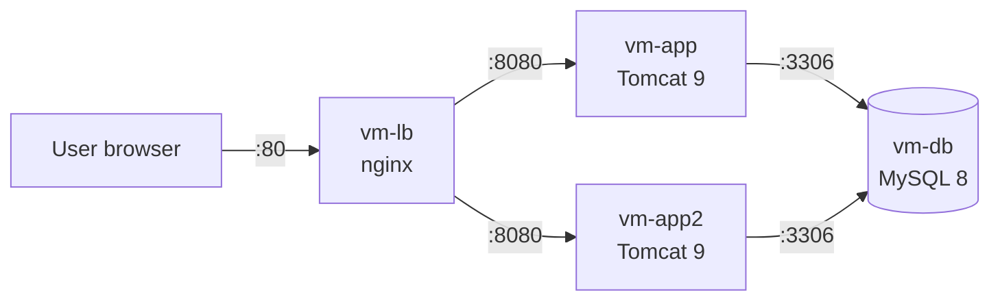

# Travel Agency: nginx Load Balancing


This branch runs the Travel Agency app on **two app nodes** behind an
**nginx load balancer**. All servers are Proxmox LXC containers, created and
configured by Ansible.

## Servers

| CT | Name | IP | Role |
|---|---|---|---|
| 301 | vm-app | `192.168.18.101` | Java 17 + Tomcat 9, app on :8080 |
| 305 | vm-app2 | `192.168.18.105` | Java 17 + Tomcat 9, app on :8080 |
| 302 | vm-db | `192.168.18.102` | MySQL 8 |
| 306 | vm-lb | `192.168.18.106` | nginx load balancer on :80 |

## How it works



1. The user opens `http://192.168.18.106/`.
2. nginx sends the request to one of the app nodes (`upstream travelagency`).
3. Both app nodes use the same MySQL database, so they show the same data.

### Sticky sessions

The login session lives in Tomcat memory on one node. If the next request goes
to the other node, the user is logged out. So nginx uses `ip_hash`: requests
from one client IP always go to the same node.

### Failover

If a node does not answer, nginx marks it as down for 10 seconds
(`max_fails=3 fail_timeout=10s`) and sends the request to the other node
(`proxy_next_upstream error timeout http_502 http_503`).

## Files

| File | Purpose |
|---|---|
| `ansible/inventory.ini` | Hosts and groups: `app`, `db`, `lb` |
| `ansible/group_vars/all.yml` | Settings (`app_port`, `lb_port`, DB settings) |
| `ansible/provision.yml` | Creates the LXC containers via the Proxmox API |
| `ansible/app.yml` | MySQL on `db`, build + deploy on every host in `app` |
| `ansible/lb.yml` | Installs nginx and adds the load balancer config |
| `ansible/nginx-lb.conf.j2` | nginx config; the server list is built from the `app` group |
| `ansible/travelagency.conf.j2` | systemd drop-in with the DB env vars for Tomcat |

To add a third app node, add it to the `[app]` group in `inventory.ini` and run
`app.yml` and `lb.yml` again.

## Run

```bash
cd ansible
cp .env.example .env        # then put real values into .env
set -a; source .env; set +a
ansible-galaxy collection install -r requirements.yml
ansible-playbook provision.yml
ansible-playbook app.yml
ansible-playbook lb.yml
```

## Check

Site works through the load balancer:

```bash
curl -I http://192.168.18.106/
```

See which node answers (watch the access log on each node):

```bash
tail -f /var/log/tomcat9/localhost_access_log.*.txt
```

Failover test: stop one node and open the site again.

```bash
ssh root@192.168.18.101
systemctl stop tomcat9
```

The site still works through `vm-app2`. Start the node again with
`systemctl start tomcat9`.

Idempotency: a second run of `ansible-playbook lb.yml` must show `changed=0`.
