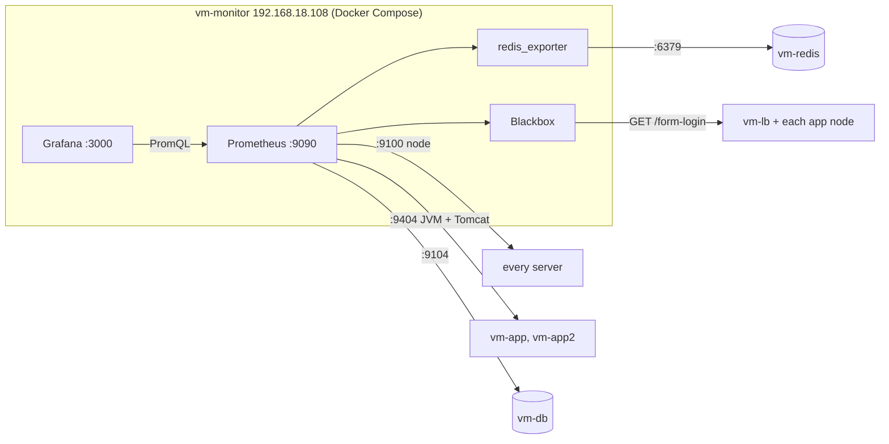

# Travel Agency: monitoring with Prometheus and Grafana


One new server, `vm-monitor`, collects metrics from every server and shows them in Grafana.
Everything is installed by one playbook: `ansible/monitoring.yml`.

| What we watch | Exporter | Where it runs | Port |
|---|---|---|---|
| CPU, RAM, disk, network of every server | `node_exporter` (Ubuntu package) | every server | 9100 |
| JVM heap, GC, threads, Tomcat requests and errors | JMX exporter (`-javaagent` in Tomcat) | `vm-app`, `vm-app2` | 9404 |
| MySQL connections, queries, slow queries | `mysqld_exporter` (Ubuntu package) | `vm-db` | 9104 |
| Redis memory, clients, session keys | `redis_exporter` | `vm-monitor` (Docker) | 9121 |
| Real CPU of every LXC (node_exporter CPU is wrong in LXC) | `prometheus-pve-exporter` (Proxmox API) | `vm-monitor` (Docker) | 9221 |
| The site from outside: up or down, response time | Blackbox exporter | `vm-monitor` (Docker) | 9115 |

## How it works



1. Prometheus **pulls** (scrapes) `/metrics` from every exporter every 15 s and keeps the data for 15 days.
2. The target list is made by Ansible from `inventory.ini` (`ansible/prometheus.yml.j2`).
   A new app node in `[app]` is monitored after the next `monitoring.yml` run.
3. Grafana gets the Prometheus data source and the **TravelAgency overview** dashboard on start
   (provisioning), no clicks needed.
4. Alert rules (`prometheus/alerts.yml`) are evaluated by Prometheus and shown in **Alerts**.

## Servers

| CT | Name | IP | Role |
|---|---|---|---|
| 309 | vm-monitor | `192.168.18.108` | Prometheus, Grafana, Blackbox, redis_exporter (Docker) |

## Files

| File | Purpose |
|---|---|
| `ansible/monitoring.yml` | Installs all exporters and starts the monitoring stack |
| `ansible/prometheus.yml.j2` | Prometheus config; targets come from the inventory |
| `ansible/inventory.ini`, `ansible/provision.yml` | New host `vm-monitor` (CT 309, nesting for Docker) |
| `ansible/group_vars/all.yml` | Monitoring settings, `GRAFANA_ADMIN_PASSWORD` and `PVE_EXPORTER_TOKEN` from env |
| `monitoring/docker-compose.yml` | Prometheus, Grafana, Blackbox, redis_exporter, pve-exporter |
| `monitoring/prometheus/alerts.yml` | Alert rules and the `lxc:cpu_used:percent` recording rule |
| `monitoring/blackbox/blackbox.yml` | HTTP check module |
| `monitoring/jmx/tomcat.yml` | JMX exporter rules for Tomcat |
| `monitoring/grafana/provisioning/` | Data source and dashboard provider |
| `monitoring/grafana/dashboards/travelagency.json` | The overview dashboard |

## Run

Once, on the **Proxmox host**: a read-only user and token for pve-exporter.

```bash
pveum user add monitoring@pve --comment "Prometheus read-only"
pveum acl modify / --users monitoring@pve --roles PVEAuditor
pveum user token add monitoring@pve prometheus --privsep 0   # copy the "value"
```

```bash
cd ansible
# add GRAFANA_ADMIN_PASSWORD=... and PVE_EXPORTER_TOKEN=<value> to .env
set -a; source .env; set +a
ansible-playbook provision.yml     # creates vm-monitor (existing containers are not changed)
ansible-playbook monitoring.yml
```

Open:

- Grafana: `http://192.168.18.108:3000` (user `admin`, password from `GRAFANA_ADMIN_PASSWORD`)
- Prometheus targets: `http://192.168.18.108:9090/targets`

Tomcat is restarted once (to load the Java agent), **one node at a time** (`serial: 1`),
so the site stays up behind the load balancer.

## Check

```bash
curl -s http://192.168.18.101:9404/metrics | grep tomcat_requestcount_total   # JVM + Tomcat
curl -s http://192.168.18.102:9104/metrics | grep '^mysql_up'                 # mysql_up 1
curl -s http://192.168.18.106:9100/metrics | grep -c '^node_'                 # many lines
```

- Prometheus → Status → Targets: every target is **UP**.
- Grafana → Dashboards → TravelAgency → **TravelAgency overview**: all panels have data.
- `systemctl stop tomcat9` on `vm-app2`: after 1 minute **App nodes up** is `1`, alerts
  `TargetDown` and `SiteDown` are firing, and **Site (load balancer)** is still **UP**.
- A second run of `monitoring.yml` shows no Tomcat restart.

## Tool versions

| Tool | Version |
|---|---|
| Prometheus | `prom/prometheus:v3.15.1` |
| Grafana | `grafana/grafana:13.2.5` |
| Blackbox exporter | `prom/blackbox-exporter:v0.29.1` |
| redis_exporter | `oliver006/redis_exporter:v1.95.0` |
| Proxmox VE exporter | `prompve/prometheus-pve-exporter:3.10.1` |
| JMX exporter (Java agent) | 1.0.1 |
| node_exporter | 1.3.1 (Ubuntu 22.04 package) |
| mysqld_exporter | 0.13.0 (Ubuntu 22.04 package) |
| Docker / Compose | `docker.io` + `docker-compose-v2` (Ubuntu 22.04 packages) |
