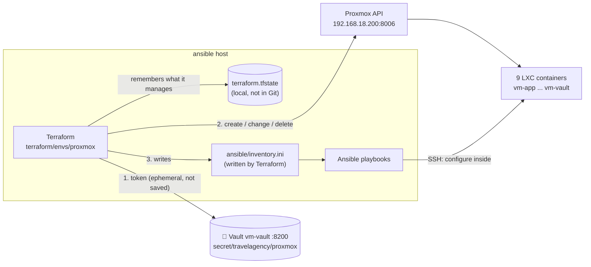

# Infrastructure as Code: Terraform

The LXC containers of TravelAgency in Proxmox are described in **Terraform** code.
Before, `ansible/provision.yml` created them. Now Terraform does, and Ansible only configures
what is **inside** the servers (packages, configs, the app).

| Tool | Answers the question | Files |
|------|----------------------|-------|
| Terraform | **Which servers exist** and how big they are | `terraform/` |
| Ansible | **What runs inside** each server | `ansible/` |
| Vault | **Secrets** for both | `vault/`, Vault on vm-vault |



## Folders

```
terraform/
├── modules/
│   └── proxmox-lxc/        # HOW to make one server on Proxmox (one LXC container)
├── envs/
│   └── proxmox/            # WHAT exists here: the list of servers + Proxmox/Vault settings
│       ├── terraform.tfvars    # the list of servers (edit this one)
│       ├── providers.tf        # Vault + Proxmox logins
│       ├── main.tf             # one module call per server
│       └── inventory.tf        # writes ansible/inventory.ini
└── templates/
    └── inventory.ini.tftpl # Ansible inventory template, the same for every platform
```

**Why like this.** A module is a reusable "recipe". `modules/proxmox-lxc` knows Proxmox; the rest does not.
For the cloud stage we add `modules/<cloud>-vm` with the **same common inputs**
(`name`, `ip`, `cores`, `memory`, `disk`, `ssh_public_key`, `tags`) and the **same outputs** (`name`, `ip`),
and a new folder `envs/<cloud>` next to `envs/proxmox`. The list of servers and the inventory template stay.
Each folder in `envs/` has its own state, so Proxmox and the cloud never touch each other.

## What Terraform manages

| Server | vmid | IP | CPU | RAM MB | Disk GB | Nesting |
|--------|------|----|-----|--------|---------|---------|
| vm-app | 301 | 192.168.18.101 | 1 | 2048 | 8 | |
| vm-db | 302 | 192.168.18.102 | 1 | 2048 | 8 | |
| vm-jenkins | 303 | 192.168.18.103 | 1 | 2048 | 16 | ✅ |
| vm-agent | 304 | 192.168.18.104 | 4 | 4096 | 32 | ✅ |
| vm-app2 | 305 | 192.168.18.105 | 1 | 2048 | 8 | |
| vm-lb | 306 | 192.168.18.106 | 1 | 512 | 8 | |
| vm-redis | 307 | 192.168.18.107 | 1 | 512 | 8 | |
| vm-monitor | 309 | 192.168.18.108 | 2 | 2048 | 16 | ✅ |
| vm-vault | 310 | 192.168.18.109 | 1 | 512 | 8 | |

All: unprivileged Ubuntu 22.04 LXC, `local-lvm`, bridge `vmbr0`, gateway `192.168.18.1`,
root SSH key `~/.ssh/id_ed25519.pub`, start on boot, tags `terraform` + group.
The containers were created by Ansible earlier and **imported** into Terraform (not re-created).

## Secrets

Terraform needs one secret: the Proxmox API token. It comes from Vault, `secret/travelagency/proxmox`, key
`token_secret` (the same one Ansible used). It is read as an **ephemeral** resource: kept in memory during the
run, never written to `terraform.tfstate` or to a plan file. The token ID `ansible@pve!ansible` is not secret.

Vault login is your normal one: `vault login -method=userpass username=nazariy` (token in `~/.vault-token`).

## Run

On the ansible host (needs `terraform` >= 1.10 and `vault` CLI):

```bash
vault login -method=userpass username=nazariy   # once in 8 hours (Vault must be unsealed)
cd terraform/envs/proxmox
terraform init        # first time / after a provider version change: downloads providers
terraform plan        # shows what WOULD change. Read it!
terraform apply       # shows the plan again, asks "yes", then changes Proxmox
terraform output      # names and IPs
```

| Task | What to do |
|------|------------|
| New server | add a line to `terraform.tfvars` (free `vm_id` and `ip`), `terraform apply`, then the Ansible playbook for its group |
| More RAM / CPU | change the line, `terraform apply` (RAM change **restarts** the container) |
| Remove a server | delete the line, `terraform apply` (**deletes the container and its disk**) |
| See what Terraform manages | `terraform state list` |
| Check that Proxmox = code | `terraform plan` → `No changes.` |

Never change these containers by hand in the Proxmox UI: the next `terraform plan` shows it as a change and
`apply` puts the code value back.

## Careful

- `vm-vault` restart = Vault is **sealed**: unseal it (root README.md) before Ansible/Terraform work again.
- `vm-db` delete = the database is gone. Read every `terraform plan` before `apply`;
  `must be replaced` or `destroy` next to vm-db / vm-vault = stop.
- `terraform.tfstate` is the memory of Terraform. Lost state = Terraform does not know the containers
  (they still run; fix: import again). Keep a copy; remote state comes with the cloud stage.
- To recreate vm-vault itself Terraform needs Vault (chicken and egg). If vm-vault is lost, create it
  once with the old playbook: `git show secrets-vault:ansible/provision.yml > /tmp/provision.yml`.

Details and choices: [REPORT.md](REPORT.md).
