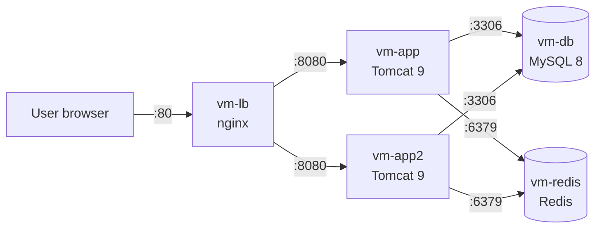
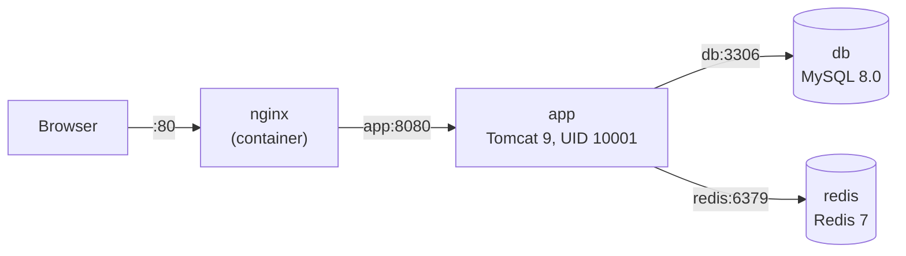

# Travel Agency: Load Balancing + Redis Sessions + Docker


The Travel Agency web app (Java 17, Spring MVC 5, Hibernate, JSP) runs on
**two app nodes** behind an **nginx load balancer**. HTTP sessions are stored
in **Redis**, so a user stays logged in on any node. The database schema is
managed by **Flyway**.

All servers are Proxmox LXC containers (Ubuntu 22.04), created and configured
by Ansible. There are no manual steps on the servers.

The app is also packed into a **Docker image** (Tomcat 9 + JRE 17, non-root user).
`docker compose` runs the same stack on one machine: nginx → app → MySQL + Redis.
Jenkins builds the image, scans it with **Trivy** and pushes it to
**Docker Hub** (`nazariybu/travelagency`).

## Servers

| CT | Name | IP | Role |
|---|---|---|---|
| 306 | vm-lb | `192.168.18.106` | nginx load balancer on :80 |
| 301 | vm-app | `192.168.18.101` | Java 17 + Tomcat 9, app on :8080 |
| 305 | vm-app2 | `192.168.18.105` | Java 17 + Tomcat 9, app on :8080 |
| 302 | vm-db | `192.168.18.102` | MySQL 8 |
| 307 | vm-redis | `192.168.18.107` | Redis, shared HTTP sessions on :6379 |

## How it works



1. The user opens `http://192.168.18.106/`.
2. nginx sends the request to one of the app nodes (`upstream travelagency`).
3. Both nodes use the same MySQL database, so they show the same data.
4. Both nodes keep the login session in the same Redis, so the user is not
   logged out when the next request goes to the other node.

## What was done

| Step | Problem | Solution |
|---|---|---|
| Load balancer | One app node is a single point of failure | nginx in front of two Tomcat nodes, with failover |
| Shared sessions | Sessions live in Tomcat memory: the other node does not know the user | Spring Session stores sessions in Redis |
| DB migrations | `hbm2ddl.auto: create` + `insert.sql` deleted all data on every start, and two nodes did it at the same time | Flyway runs each SQL file once; Hibernate only checks the schema (`validate`) |
| Docker image | The app runs only on a VM prepared by Ansible | Multi-stage `Dockerfile`: Maven + JDK 17 build, Tomcat 9 + JRE 17 run, non-root user |
| Local stack | Many VMs are needed to test the full setup | `docker-compose.yml`: nginx, app, MySQL, Redis on one host |
| Image registry + scan | No versioned artifact except the WAR | Jenkins builds the image, scans it with Trivy, pushes it to Docker Hub |

### nginx load balancer

- The server list is built from the `app` group in `inventory.ini`, so a new node
  needs only one new line in the inventory.
- **Failover**: `max_fails=3 fail_timeout=10s` skips a broken node for 10 seconds.
  `proxy_next_upstream error timeout http_502 http_503` sends the same request to
  the other node, so the user does not see an error.
- `X-Forwarded-*` headers pass the real client IP to Tomcat.
- `nginx -t` checks the config before reload. A broken config stops the playbook,
  and nginx keeps the old working config.

### Redis sessions

- `spring-session-data-redis` + `lettuce-core` in `pom.xml`.
- `RedisSessionConfig.java`: `@EnableRedisHttpSession`, session timeout 30 minutes.
- `SessionInitializer.java`: adds the session filter **before** Spring Security,
  so Security reads the login from Redis.
- `Security.java`: `mybookings` is `transient`. A session object must be
  serializable to go to Redis, and a Hibernate collection should not be stored there.
- Redis listens on the local network and asks for a password (`requirepass`).

### Flyway migrations

- `db/migration/V1__create_schema.sql`: creates the tables.
- `db/migration/V2__seed_data.sql`: test data (the old `insert.sql`).
- Flyway saves the applied versions in the table `flyway_schema_history`.
  On the next start nothing runs again, so the data stays after a deploy.
- To change the schema, add a new file `V3__<what>.sql`. Do not edit old files.

### Docker image

- **Stage 1** (`maven:3.9-eclipse-temurin-17`): builds `TravelAgency.war`.
  JDK 17 is required: Lombok 1.18.20 fails on JDK 21.
  `pom.xml` is copied first, so the dependency layer is cached.
- **Stage 2** (`tomcat:9.0-jre17-temurin-jammy`): only the JRE and Tomcat, no Maven
  and no sources. The WAR is deployed as `ROOT.war`, the same as on the VMs.
- **Non-root**: user `app` with fixed UID/GID `10001` (`USER 10001`). It can write
  only to `logs`, `temp`, `work`, `webapps`; `conf` and `bin` stay owned by root.
- `.dockerignore` keeps `.git`, `target`, `ansible` and `.env` out of the build context.

### docker compose + nginx reverse proxy



- Only nginx publishes a port (`${HTTP_PORT:-80}`). Tomcat, MySQL and Redis are
  reachable only inside the compose network.
- `nginx/nginx.conf`: `upstream` on `app:8080` (Docker DNS), `X-Forwarded-*`
  headers, `server_tokens off`, health page `/nginx-health`.
- `app` starts only after `db` and `redis` are healthy (`depends_on: condition: service_healthy`).
- Secrets come from `.env` next to `docker-compose.yml` (see `.env.example`).
  Compose stops with an error if `DB_PASSWORD`, `DB_ROOT_PASSWORD` or `REDIS_PASSWORD` is empty.
- MySQL data is kept in the named volume `db-data`.

### Jenkins pipeline

| Stage | What it does |
|---|---|
| Build & Test | `mvn clean package` in `maven:3.9-eclipse-temurin-17` |
| Archive | Saves `target/TravelAgency.war` |
| Docker Build | `docker build -t nazariybu/travelagency:<build number> -t ...:latest .` |
| Trivy Scan | `aquasec/trivy:0.57.1`, `HIGH,CRITICAL`, `--ignore-unfixed`; report saved as `trivy-report.txt` |
| Push to Docker Hub | Only on `load-balancing-redis`; login with the `dockerhub-creds` credential (`--password-stdin`) |
| Deploy | Only on `load-balancing-redis`; `ansible-playbook app.yml` with the built WAR |

Trivy runs in **report-only** mode (`--exit-code 0`): old libraries in `pom.xml`
(Spring 5.3.9, logback 1.2.3, mysql-connector 8.0.x, jetty 9.4) have known CVEs.
To make it a quality gate, use `--severity CRITICAL --exit-code 1`.

Jenkins needs a credential `dockerhub-creds` of type **Username with password**:
the Docker Hub login and an **access token** (Read & Write), not the account password.

## Files

| File | Purpose |
|---|---|
| `ansible/inventory.ini` | Hosts and groups: `app`, `db`, `lb`, `redis` |
| `ansible/group_vars/all.yml` | Settings; secrets come from env vars |
| `ansible/.env.example` | Example of the secrets file |
| `ansible/provision.yml` | Creates the LXC containers via the Proxmox API |
| `ansible/redis.yml` | Installs Redis, sets the bind address and the password |
| `ansible/app.yml` | MySQL on `db`, build + deploy on every host in `app` |
| `ansible/lb.yml` | Installs nginx and adds the load balancer config |
| `ansible/nginx-lb.conf.j2` | nginx config; the server list is built from the `app` group |
| `ansible/travelagency.conf.j2` | systemd drop-in with DB and Redis env vars for Tomcat |
| `src/main/resources/application.properties` | App settings, read from env vars |
| `src/main/resources/db/migration/` | Flyway SQL migrations |
| `Dockerfile` | Multi-stage image: build on JDK 17, run on Tomcat 9 + JRE 17 as UID 10001 |
| `.dockerignore` | Files that are not sent to the Docker build |
| `docker-compose.yml` | Local stack: `nginx`, `app`, `db`, `redis` |
| `nginx/nginx.conf` | nginx reverse proxy config for compose |
| `.env.example` | Example of the secrets file for compose |
| `Jenkinsfile` | CI/CD: build, archive, Docker build, Trivy, push, deploy |

The app reads these env vars (set by `travelagency.conf.j2`):
`DB_TRAVELAGENCY_URL`, `DB_TRAVELAGENCY_USER`, `DB_TRAVELAGENCY_PASSWORD`,
`REDIS_TRAVELAGENCY_HOST`, `REDIS_TRAVELAGENCY_PORT`, `REDIS_TRAVELAGENCY_PASSWORD`.

## Run

Redis must run before the app starts, so `redis.yml` goes before `app.yml`.

```bash
cd ansible
cp .env.example .env
```

Put real values into `.env` (`DB_PASSWORD`, `REDIS_PASSWORD`, `PROXMOX_TOKEN_SECRET`).
`.env` is in `.gitignore`.

```bash
set -a; source .env; set +a
ansible-galaxy collection install -r requirements.yml
ansible-playbook provision.yml
ansible-playbook redis.yml
ansible-playbook app.yml
ansible-playbook lb.yml
```

To add a third app node: add it to `[app]` in `inventory.ini` and to
`provision.yml`, then run `provision.yml`, `app.yml` and `lb.yml` again.

## Run with Docker

Install Docker Engine and the Compose plugin (Ubuntu 22.04):

```bash
sudo apt-get update
sudo apt-get install -y ca-certificates curl
sudo install -m 0755 -d /etc/apt/keyrings
sudo curl -fsSL https://download.docker.com/linux/ubuntu/gpg -o /etc/apt/keyrings/docker.asc
sudo chmod a+r /etc/apt/keyrings/docker.asc
echo "deb [arch=$(dpkg --print-architecture) signed-by=/etc/apt/keyrings/docker.asc] https://download.docker.com/linux/ubuntu $(. /etc/os-release && echo $VERSION_CODENAME) stable" | sudo tee /etc/apt/sources.list.d/docker.list > /dev/null
sudo apt-get update
sudo apt-get install -y docker-ce docker-ce-cli containerd.io docker-buildx-plugin docker-compose-plugin
sudo usermod -aG docker $USER   # then log out and in again
```

Start the stack:

```bash
cp .env.example .env            # put real passwords into .env
docker compose up -d --build
docker compose ps
```

Or run the image from Docker Hub without a local build
(set `DOCKERHUB_USER=nazariybu` and `APP_TAG` in `.env`):

```bash
docker compose pull app
docker compose up -d
```

Build and push the image by hand:

```bash
docker login -u nazariybu          # password = Docker Hub access token
docker build -t nazariybu/travelagency:1.0.0 .
docker tag nazariybu/travelagency:1.0.0 nazariybu/travelagency:latest
docker push nazariybu/travelagency:1.0.0
docker push nazariybu/travelagency:latest
```

Stop: `docker compose down` (add `-v` to delete the database volume).

## Check

Site works through the load balancer (`200` or `302`):

```bash
curl -I http://192.168.18.106/
```

Redis answers and stores sessions (after a login):

```bash
ssh root@192.168.18.107
redis-cli -a "$REDIS_PASSWORD" --no-auth-warning keys 'spring:session:*'
```

Shared sessions: log in, then stop the node that served you. The user must
stay logged in on the other node.

```bash
tail -f /var/log/tomcat9/localhost_access_log.*.txt   # on each node: who answers
systemctl stop tomcat9                                # on that node
systemctl start tomcat9                               # bring it back
```

Flyway: migrations ran once.

```bash
ssh root@192.168.18.102
mysql travelagency -e "SELECT version, description, success FROM flyway_schema_history;"
```

Idempotency: a second run of `redis.yml`, `app.yml` and `lb.yml` must show `changed=0`.

Docker stack:

```bash
docker compose ps                              # db and redis are (healthy), only nginx has 0.0.0.0:80
curl -I http://localhost/form-login            # HTTP/1.1 200, Server: nginx
curl http://localhost/nginx-health             # ok
docker compose exec app id                     # uid=10001(app) gid=10001(app)
docker compose exec redis sh -c 'redis-cli -a "$REDIS_PASSWORD" --no-auth-warning keys "spring:session*"'
```

Trivy scan of a local image:

```bash
docker run --rm -v /var/run/docker.sock:/var/run/docker.sock aquasec/trivy:0.57.1 \
  image --scanners vuln --severity HIGH,CRITICAL --ignore-unfixed nazariybu/travelagency:latest
```

## Tool versions

| Tool | Version |
|---|---|
| Ubuntu (containers) | 22.04 |
| nginx | 1.18 |
| Tomcat | 9 |
| Java | OpenJDK 17 |
| MySQL | 8 |
| Redis | 6 (Ubuntu 22.04 package) |
| Flyway | 9.22.3 |
| Spring Session Data Redis | 2.5.2 |
| Docker base images | `maven:3.9-eclipse-temurin-17`, `tomcat:9.0-jre17-temurin-jammy` |
| Compose images | `nginx:1.27-alpine`, `mysql:8.0`, `redis:7-alpine` |
| Trivy | 0.57.1 |
