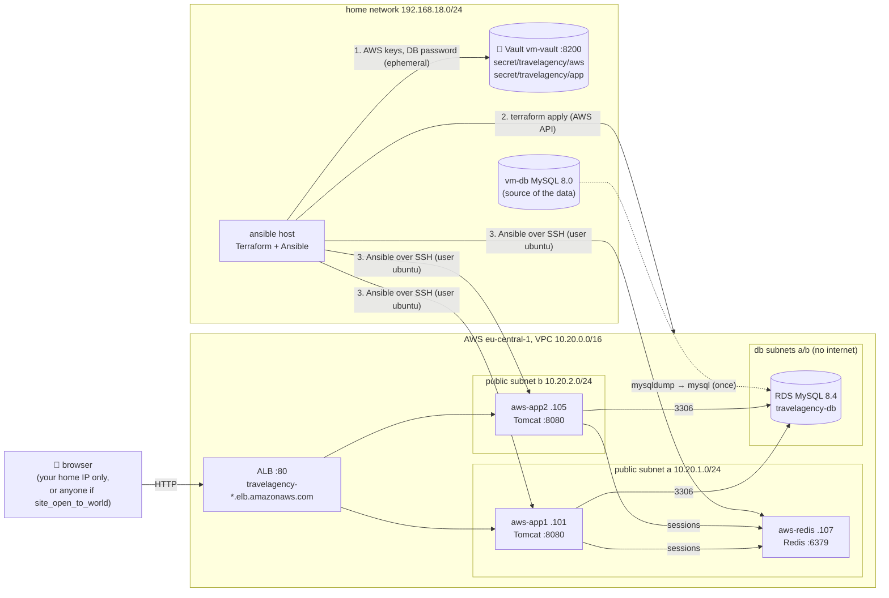

# Migrate to the cloud: TravelAgency in AWS

The same application that runs at home in Proxmox now also runs in **AWS**, created by **Terraform**
(`terraform/envs/aws`) and configured by the **same Ansible playbooks** (`app.yml`, `redis.yml`).
The home servers keep working; AWS is a second copy for the demo and is destroyed after it.

| At home (Proxmox) | In AWS | Strategy |
|-------------------|--------|----------|
| vm-app, vm-app2 (LXC, Tomcat 9) | aws-app1, aws-app2 (EC2 t3.micro, Ubuntu 22.04, Tomcat 9) | **rehost** (lift and shift) |
| vm-redis (LXC, Redis) | aws-redis (EC2 t3.micro, Redis) | **rehost** |
| vm-lb (nginx) | Application Load Balancer (ALB) | **replatform** (managed service) |
| vm-db (MySQL 8.0) | RDS for MySQL 8.4, db.t4g.micro | **replatform** (managed service), data moved with `mysqldump` |
| vm-vault (Vault) | stays at home | Terraform and Ansible on the ansible host read it |
| Jenkins, monitoring, Loki | stay at home | not part of this stage |



## Folders

```
terraform/
├── modules/
│   ├── proxmox-lxc/          # one LXC container in Proxmox (stage IaC)
│   └── aws-ec2/              # one EC2 server in AWS: same input names (name, ip, disk, ssh_public_key, tags)
│       └── cloud-init.yaml.tftpl  # first boot: hostname, SSH key for ubuntu, swap
├── envs/
│   ├── proxmox/              # home servers (own state)
│   └── aws/                  # AWS (own state)
│       ├── terraform.tfvars  # the list of EC2 servers (edit this one)
│       ├── providers.tf      # Vault + AWS logins
│       ├── network.tf        # VPC, subnets, internet gateway
│       ├── security.tf       # security groups (firewall)
│       ├── main.tf           # one module call per server
│       ├── alb.tf            # load balancer
│       ├── database.tf       # RDS MySQL
│       └── inventory.tf      # writes ansible/inventory-aws.ini
└── templates/
    └── inventory.ini.tftpl   # one inventory template for both platforms
```

Ansible needed 3 small changes to work on both platforms (`group_vars/all.yml`, `redis.yml`):
`db_host` = `db_endpoint` (RDS) if the inventory gives it, `redis_host` and the Redis `bind` use
`private_ip` if the inventory gives it, `vault_url` = `vault_address` if the inventory gives it.
The home inventory gives none of them, so at home nothing changes.

## Secrets

| Secret | Where | Used by |
|--------|-------|---------|
| AWS access key of the IAM user `terraform-travelagency` | Vault `secret/travelagency/aws` (`access_key_id`, `secret_access_key`) | Terraform AWS provider, `ephemeral` (never in the state) |
| MySQL password | Vault `secret/travelagency/app` (`db_password`), the same as at home | RDS master password via `password_wo` (write-only, never in the state); Tomcat via Ansible |
| Redis password | Vault `secret/travelagency/app` (`redis_password`) | Ansible (`redis.yml`, `app.yml`) |

Check: `grep -c -e secret_access_key -e db_password terraform/envs/aws/terraform.tfstate` → `0`.

## Cost and safety

- AWS Budget `travelagency-monthly` (10 USD, credits NOT included, e-mail at 10 %, 50 %, 100 %), created in the console
  before any resource.
- Free Tier / credits size everywhere: EC2 `t3.micro`, RDS `db.t4g.micro` 20 GB, no NAT gateway, no Multi-AZ.
- RDS MySQL **8.4**: MySQL 8.0 left standard support on 2026-07-31 and costs extra (Extended Support);
  `engine_lifecycle_support = open-source-rds-extended-support-disabled` makes sure we never pay it.
- Every resource has the tag `Project = travelagency` (provider `default_tags`).

## Run

On the ansible host (needs `terraform` >= 1.11, `vault` CLI, Vault unsealed):

```bash
vault login -method=userpass username=nazariy
cd terraform/envs/aws
terraform init
terraform plan                 # Plan: 24 to add
terraform apply                # ~10 minutes (RDS is the slowest)
terraform output               # site_url, servers, db_endpoint

cd ../../../ansible
ansible -i inventory-aws.ini all -m ping
ansible-playbook -i inventory-aws.ini redis.yml
# once: move the data from vm-db to RDS (below)
ansible-playbook -i inventory-aws.ini app.yml
```

### Migrate the data (once, before app.yml)

RDS has no public address, so the dump goes through aws-app1 (it is inside the VPC):

```bash
# ansible host: dump the home database (vm-db, root uses the unix socket, no password)
ssh root@192.168.18.102 "mysqldump --single-transaction --no-tablespaces --set-gtid-purged=OFF travelagency | gzip" > ~/aws-migration/travelagency.sql.gz
scp ~/aws-migration/travelagency.sql.gz ubuntu@<aws-app1 IP>:/tmp/

# aws-app1: load it into RDS (password: vault kv get -mount=secret -field=db_password travelagency/app)
sudo apt-get install -y mysql-client
gunzip -c /tmp/travelagency.sql.gz | mysql -h <db_endpoint> -u travel -p travelagency
```

The dump contains `flyway_schema_history`, so Flyway sees V1 and V2 as done and does not run them again.

Destroy everything (and check the console after it):

```bash
cd terraform/envs/aws
terraform destroy              # Destroy complete! Resources: 24 destroyed.
```

Details, choices, costs and results: [REPORT.md](REPORT.md).