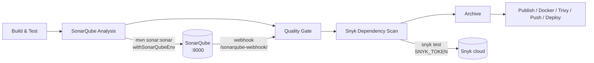

# Travel Agency: code quality (SonarQube) and dependency scan (Snyk)


Jenkins checks every build in three ways before it publishes anything:

| Tool | What it checks | Where it runs |
|---|---|---|
| **SonarQube** | Our own Java code: bugs, vulnerable code, duplicates, code smells | Self-hosted, Docker on Proxmox LXC |
| **Snyk** | Maven dependencies from `pom.xml` and known CVEs in them | Snyk cloud, CLI in Jenkins |
| **Trivy** | The Docker image: OS packages and everything inside | Jenkins, already in place |

## How it works



1. **SonarQube Analysis** runs the Maven scanner in `maven:3.9-eclipse-temurin-17`.
   `withSonarQubeEnv('sonarqube')` gives it the server URL and token from Jenkins.
2. **Quality Gate**: SonarQube processes the report in the background and calls the
   Jenkins webhook when it is done. `waitForQualityGate abortPipeline: true` stops the
   pipeline if the gate is red (timeout 5 min).
3. **Snyk Dependency Scan** runs `snyk test` in `snyk/snyk:maven-3-jdk-17`.
   Exit code `1` (HIGH/CRITICAL found) marks the build **UNSTABLE**; `2`/`3`
   (Snyk error) fails it. The report is archived as `snyk-report.txt`.
   On `load-balancing-redis`, `snyk monitor` also sends a snapshot to the Snyk UI.

## Files

| File | Purpose |
|---|---|
| `sonarqube/docker-compose.yml` | SonarQube Community Build 26.9 + PostgreSQL 16 |
| `Jenkinsfile` | Stages `SonarQube Analysis`, `Quality Gate`, `Snyk Dependency Scan` |
| `pom.xml` | Duplicate dependencies removed (Snyk's Maven refused the POM) |
| `ci/dedupe-pom.py` | Removes duplicate `<dependency>` entries, keeps the last one |

## Setup

### 1. Host (Proxmox)

SonarQube embeds Elasticsearch, which needs `vm.max_map_count >= 524288`.
An LXC uses the kernel of the Proxmox host, so set it **on the host**:

```bash
sysctl -w vm.max_map_count=524288
echo 'vm.max_map_count=524288' > /etc/sysctl.d/99-sonarqube.conf
```

The LXC with SonarQube needs about 4 GB of free RAM.

### 2. SonarQube

```bash
cd sonarqube
echo 'SONAR_DB_PASSWORD=...' > .env
docker compose up -d
curl -s http://localhost:9000/api/system/status   # "status":"UP"
```

First login `admin` / `admin` (change it). **My Account → Security → Generate Tokens**,
type **Global Analysis Token**.

Webhook: **Administration → Configuration → Webhooks → Create**,
URL `http://<jenkins-ip>:8080/sonarqube-webhook/`.

### 3. Jenkins

Plugin **SonarQube Scanner**.

| Credential ID | Kind | Value |
|---|---|---|
| `sonarqube-token` | Secret text | SonarQube `sqa_...` token |
| `snyk-token` | Secret text | Snyk Auth Token (app.snyk.io → Account settings) |

**Manage Jenkins → System → SonarQube servers**: Environment variables ✔,
Name **`sonarqube`**, URL `http://<sonarqube-ip>:9000`, token `sonarqube-token`.

## Run by hand

```bash
# SonarQube
export SONAR_TOKEN=sqa_...
docker run --rm -v "$PWD":/src -w /src -e SONAR_TOKEN maven:3.9-eclipse-temurin-17 \
  mvn -B clean verify org.sonarsource.scanner.maven:sonar-maven-plugin:5.1.0.4751:sonar \
  -Dsonar.host.url=http://<sonarqube-ip>:9000 -Dsonar.projectKey=travelagency

# Snyk
export SNYK_TOKEN=...
docker run --rm -e SNYK_TOKEN -v "$PWD":/app -w /app \
  snyk/snyk:maven-3-jdk-17 snyk test --file=pom.xml --severity-threshold=high
```

## Check

- Jenkins build page: **SonarQube Quality Gate → TravelAgency: Passed**, server-side processing **Success**.
- Artifacts: `snyk-report.txt`, `trivy-report.txt`, `TravelAgency.war`.
- SonarQube → Webhooks → `jenkins`: green **Last delivery**.
- SonarQube project `travelagency`: last analysis time = build time.

## Troubleshooting

| Error | Fix |
|---|---|
| `vm.max_map_count [65530] is too low` | Set it on the Proxmox host, not in the LXC |
| `Quality Gate` waits 5 min, then timeout | Webhook is missing or SonarQube cannot reach Jenkins |
| `No SonarQube server named sonarqube` | Server name in Manage Jenkins → System must be `sonarqube` |
| `Connection refused` to `:9000` | Use the IP, not `localhost` (Maven runs in a container) |
| Snyk `SNYK-OS-MAVEN-0018 Cannot build Maven dependency tree` | Duplicate dependencies in `pom.xml`: `python3 ci/dedupe-pom.py pom.xml` |
| Snyk `EACCES ... mkdir '/.config'` | `HOME = "${env.WORKSPACE}"` in the stage environment |
| Snyk `Authentication failed` | Wrong token in `snyk-token` |

## Tool versions

| Tool | Version |
|---|---|
| SonarQube | `sonarqube:26.9.0.129388-community` |
| PostgreSQL | `postgres:16-alpine` |
| sonar-maven-plugin | 5.1.0.4751 |
| Snyk CLI image | `snyk/snyk:maven-3-jdk-17` |
| Jenkins | 2.541.3 |