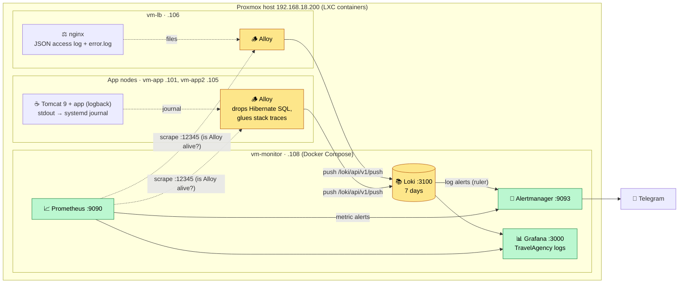

# Central logging with Loki

Logs of all servers in one place. **Grafana Alloy** on every server reads the logs and pushes them to
**Loki** on vm-monitor. **Grafana** shows them next to the metrics (same time axis, same `instance` names).

Before: to find an error you had to `ssh` to vm-app, then to vm-app2, then to vm-lb and `grep` there.
Now: one search in Grafana over all servers.



## What is collected

| Server | Source | Labels in Loki | What you find there |
|--------|--------|----------------|---------------------|
| vm-app, vm-app2 | systemd journal of `tomcat9.service` | `job="tomcat"`, `instance` | Tomcat start/stop, our logs (`logback`), Java errors with stack traces |
| vm-lb | `/var/log/nginx/travelagency_access.log` (JSON) | `job="nginx"`, `type="access"`, `instance` | Every request: status, URL, which app node answered, time |
| vm-lb | `/var/log/nginx/error.log` | `job="nginx"`, `type="error"`, `instance` | `connect() failed`, `upstream timed out` (an app node is down or slow) |

Not sent: `Hibernate: select ...` lines (`hibernate.show_sql=true` prints ~300 per page). Alloy drops them;
how many is in Prometheus: `loki_process_dropped_lines_total{reason="hibernate_sql"}`.

Few labels on purpose: Loki indexes **only labels**, not the text. A label with many values
(URL, user, status) makes many small streams and Loki gets slow. Everything else is parsed at query time
(`| json`, `|=`, `|~`).

## Files

| File | What it is |
|------|------------|
| `monitoring/loki/loki.yml` | Loki config: one process, files on disk, retention 7 days, ruler → Alertmanager |
| `monitoring/loki/rules/fake/alerts.yml` | Alerts on logs (LogQL). `fake` = tenant name when auth is off |
| `monitoring/docker-compose.yml` | New service `loki` (`grafana/loki:3.7.9`), volume `loki-data` |
| `monitoring/grafana/provisioning/datasources/loki.yml` | Grafana data source "Loki" |
| `monitoring/grafana/dashboards/travelagency-logs.json` | Dashboard **TravelAgency logs** |
| `ansible/logging.yml` | Installs Grafana Alloy on `app` and `lb` hosts |
| `ansible/config.alloy.j2` | Alloy config: what to read, filters, where to push |
| `ansible/nginx-lb.conf.j2` | nginx writes a JSON access log (`log_format travelagency_json`) |
| `ansible/prometheus.yml.j2` | New scrape jobs `loki` and `alloy` (TargetDown if a log shipper dies) |
| `ansible/monitoring.yml` | Restarts Loki and Grafana when their files change, waits for Loki |
| `ansible/group_vars/all.yml` | `loki_host`, `loki_port`, `alloy_port`; `app_version: logging-loki` |
| `src/main/resources/logback.xml` | App log format and levels (INFO for our code, WARN for libraries) |
| `pom.xml` | Removed `slf4j-nop`: it was a second SLF4J binding that could swallow all app logs |

## Run

On the ansible host, in `ansible/`:

```bash
set -a; source .env; set +a
ansible-playbook monitoring.yml   # starts Loki, adds the data source and the dashboard
curl -s http://192.168.18.108:3100/ready          # ready
ansible-playbook lb.yml           # nginx JSON access log
ansible-playbook app.yml          # builds this branch: logback.xml, no slf4j-nop
ansible-playbook logging.yml      # Alloy on vm-app, vm-app2, vm-lb
```

Check: Prometheus → Targets: `loki` and `alloy` are UP. Alloy UI: `http://<server>:12345`.

## Search (Grafana → Explore → Loki)

| Question | LogQL |
|----------|-------|
| All app logs of vm-app | `{job="tomcat", instance="vm-app"}` |
| Errors on all nodes | `{job="tomcat"} \|~ " (ERROR\|SEVERE) \|Exception"` |
| Failed logins | `{job="tomcat"} \|= "failed login"` |
| 5xx through the load balancer | `{job="nginx", type="access"} \| json \| status >= 500` |
| Slow requests (> 1 s) | `{job="nginx", type="access"} \| json \| request_time > 1` |
| Requests per node, per minute | `sum by (upstream) (count_over_time({job="nginx", type="access"} \| json [1m]))` |
| p95 time per node | `quantile_over_time(0.95, {job="nginx", type="access"} \| json \| unwrap request_time [5m]) by (upstream)` |

`|=` contains text, `|~` matches a regex, `| json` turns JSON fields into labels for this query only.

## Alerts on logs

Loki checks the rules every minute and sends firing alerts to the same Alertmanager → Telegram.

| Alert | When |
|-------|------|
| `Nginx5xxErrors` | more than 10 responses 5xx in 5 min (for 2 min) |
| `AppErrorsInLogs` | more than 5 `ERROR`/`SEVERE` lines in 5 min on one node (for 2 min) |

Also `TargetDown` from Prometheus now covers `loki` and `alloy`: if Alloy stops, logs stop and you get a message.

Details, choices and results: [REPORT.md](REPORT.md).
