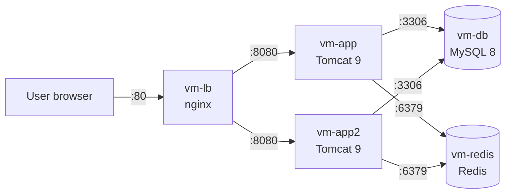

# Travel Agency: Load Balancing + Redis Sessions


The Travel Agency web app (Java 17, Spring MVC 5, Hibernate, JSP) runs on
**two app nodes** behind an **nginx load balancer**. HTTP sessions are stored
in **Redis**, so a user stays logged in on any node. The database schema is
managed by **Flyway**.

All servers are Proxmox LXC containers (Ubuntu 22.04), created and configured
by Ansible. There are no manual steps on the servers.

## Servers

| CT | Name | IP | Role |
|---|---|---|---|
| 306 | vm-lb | `192.168.18.106` | nginx load balancer on :80 |
| 301 | vm-app | `192.168.18.101` | Java 17 + Tomcat 9, app on :8080 |
| 305 | vm-app2 | `192.168.18.105` | Java 17 + Tomcat 9, app on :8080 |
| 302 | vm-db | `192.168.18.102` | MySQL 8 |
| 307 | vm-redis | `192.168.18.107` | Redis, shared HTTP sessions on :6379 |

## How it works



1. The user opens `http://192.168.18.106/`.
2. nginx sends the request to one of the app nodes (`upstream travelagency`).
3. Both nodes use the same MySQL database, so they show the same data.
4. Both nodes keep the login session in the same Redis, so the user is not
   logged out when the next request goes to the other node.

## What was done

| Step | Problem | Solution |
|---|---|---|
| Load balancer | One app node is a single point of failure | nginx in front of two Tomcat nodes, with failover |
| Shared sessions | Sessions live in Tomcat memory: the other node does not know the user | Spring Session stores sessions in Redis |
| DB migrations | `hbm2ddl.auto: create` + `insert.sql` deleted all data on every start, and two nodes did it at the same time | Flyway runs each SQL file once; Hibernate only checks the schema (`validate`) |

### nginx load balancer

- The server list is built from the `app` group in `inventory.ini`, so a new node
  needs only one new line in the inventory.
- **Failover**: `max_fails=3 fail_timeout=10s` skips a broken node for 10 seconds.
  `proxy_next_upstream error timeout http_502 http_503` sends the same request to
  the other node, so the user does not see an error.
- `X-Forwarded-*` headers pass the real client IP to Tomcat.
- `nginx -t` checks the config before reload. A broken config stops the playbook,
  and nginx keeps the old working config.

### Redis sessions

- `spring-session-data-redis` + `lettuce-core` in `pom.xml`.
- `RedisSessionConfig.java`: `@EnableRedisHttpSession`, session timeout 30 minutes.
- `SessionInitializer.java`: adds the session filter **before** Spring Security,
  so Security reads the login from Redis.
- `Security.java`: `mybookings` is `transient`. A session object must be
  serializable to go to Redis, and a Hibernate collection should not be stored there.
- Redis listens on the local network and asks for a password (`requirepass`).

### Flyway migrations

- `db/migration/V1__create_schema.sql`: creates the tables.
- `db/migration/V2__seed_data.sql`: test data (the old `insert.sql`).
- Flyway saves the applied versions in the table `flyway_schema_history`.
  On the next start nothing runs again, so the data stays after a deploy.
- To change the schema, add a new file `V3__<what>.sql`. Do not edit old files.

## Files

| File | Purpose |
|---|---|
| `ansible/inventory.ini` | Hosts and groups: `app`, `db`, `lb`, `redis` |
| `ansible/group_vars/all.yml` | Settings; secrets come from env vars |
| `ansible/.env.example` | Example of the secrets file |
| `ansible/provision.yml` | Creates the LXC containers via the Proxmox API |
| `ansible/redis.yml` | Installs Redis, sets the bind address and the password |
| `ansible/app.yml` | MySQL on `db`, build + deploy on every host in `app` |
| `ansible/lb.yml` | Installs nginx and adds the load balancer config |
| `ansible/nginx-lb.conf.j2` | nginx config; the server list is built from the `app` group |
| `ansible/travelagency.conf.j2` | systemd drop-in with DB and Redis env vars for Tomcat |
| `src/main/resources/application.properties` | App settings, read from env vars |
| `src/main/resources/db/migration/` | Flyway SQL migrations |

The app reads these env vars (set by `travelagency.conf.j2`):
`DB_TRAVELAGENCY_URL`, `DB_TRAVELAGENCY_USER`, `DB_TRAVELAGENCY_PASSWORD`,
`REDIS_TRAVELAGENCY_HOST`, `REDIS_TRAVELAGENCY_PORT`, `REDIS_TRAVELAGENCY_PASSWORD`.

## Run

Redis must run before the app starts, so `redis.yml` goes before `app.yml`.

```bash
cd ansible
cp .env.example .env
```

Put real values into `.env` (`DB_PASSWORD`, `REDIS_PASSWORD`, `PROXMOX_TOKEN_SECRET`).
`.env` is in `.gitignore`.

```bash
set -a; source .env; set +a
ansible-galaxy collection install -r requirements.yml
ansible-playbook provision.yml
ansible-playbook redis.yml
ansible-playbook app.yml
ansible-playbook lb.yml
```

To add a third app node: add it to `[app]` in `inventory.ini` and to
`provision.yml`, then run `provision.yml`, `app.yml` and `lb.yml` again.

## Check

Site works through the load balancer (`200` or `302`):

```bash
curl -I http://192.168.18.106/
```

Redis answers and stores sessions (after a login):

```bash
ssh root@192.168.18.107
redis-cli -a "$REDIS_PASSWORD" --no-auth-warning keys 'spring:session:*'
```

Shared sessions: log in, then stop the node that served you. The user must
stay logged in on the other node.

```bash
tail -f /var/log/tomcat9/localhost_access_log.*.txt   # on each node: who answers
systemctl stop tomcat9                                # on that node
systemctl start tomcat9                               # bring it back
```

Flyway: migrations ran once.

```bash
ssh root@192.168.18.102
mysql travelagency -e "SELECT version, description, success FROM flyway_schema_history;"
```

Idempotency: a second run of `redis.yml`, `app.yml` and `lb.yml` must show `changed=0`.

## Tool versions

| Tool | Version |
|---|---|
| Ubuntu (containers) | 22.04 |
| nginx | 1.18 |
| Tomcat | 9 |
| Java | OpenJDK 17 |
| MySQL | 8 |
| Redis | 6 (Ubuntu 22.04 package) |
| Flyway | 9.22.3 |
| Spring Session Data Redis | 2.5.2 |
