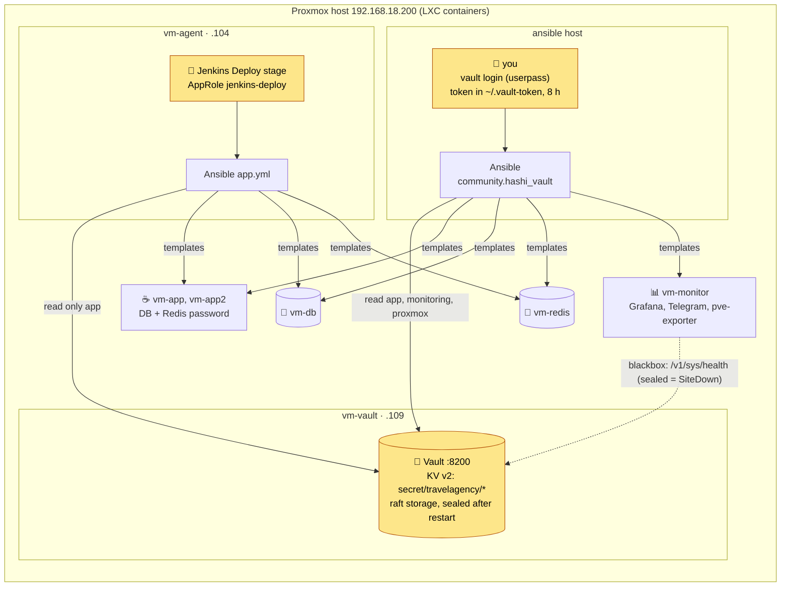

# Secrets in HashiCorp Vault

All passwords and tokens of TravelAgency live in **HashiCorp Vault** on vm-vault. They are not in Git,
not in a `.env` file on the ansible host and not in Jenkins. Ansible reads them from Vault at the moment
a playbook needs them.

Before: secrets were in `ansible/.env` (plain text on the ansible host), loaded with
`set -a; source .env`, and the DB and Redis passwords were copied a second time into Jenkins credentials.
Now: one place, every reader has its own login and may read only what it needs, every access is checked.



## What is in Vault

KV version 2 engine at `secret/` (keeps old versions of every secret).

| Path | Keys | Used by |
|------|------|---------|
| `secret/travelagency/app` | `db_password`, `redis_password` | `app.yml`, `redis.yml`, `monitoring.yml` (redis-exporter), Jenkins Deploy |
| `secret/travelagency/monitoring` | `grafana_admin_password`, `pve_exporter_token`, `telegram_bot_token`, `telegram_chat_id` | `monitoring.yml` |
| `secret/travelagency/proxmox` | `token_secret` | `provision.yml` |

Not moved (yet): `dockerhub-creds` in Jenkins (used only by the Docker Hub push), the root `.env`
for local `docker compose` on a laptop.

## Who may read what

| Who | Login (auth method) | Policy | Can |
|-----|---------------------|--------|-----|
| You on the ansible host (and Ansible started by you) | `userpass`, user `nazariy`, token for 8 h | `travelagency-admin` | read / write / delete `secret/travelagency/*` |
| Jenkins Deploy stage | `approle`, role `jenkins-deploy`, only from `192.168.18.104` | `jenkins-deploy` | read `secret/travelagency/app` only |
| root token | from `vault operator init` | `root` | everything; only for setup and emergencies |

Policies are files in [`vault/policies/`](vault/policies).

## Files

| File | What it is |
|------|------------|
| `ansible/vault.yml` | Installs Vault from the HashiCorp apt repository on `vault` hosts |
| `ansible/vault.hcl.j2` | Vault config: raft storage, UI, listener :8200 (no TLS, home lab) |
| `vault/policies/*.hcl` | Who may read/write which paths |
| `ansible/group_vars/all.yml` | `vault_url`; `vault_app`, `vault_monitoring`, `vault_proxmox` = lookups `community.hashi_vault.vault_kv2_get`; all secret variables come from them |
| `ansible/inventory.ini`, `ansible/provision.yml` | New LXC `vm-vault` (vmid 310, 192.168.18.109) |
| `ansible/requirements.yml` | + collection `community.hashi_vault` |
| `ansible/jenkins.yml` | + `hvac` and `community.hashi_vault` on the Jenkins agent |
| `Jenkinsfile` | Deploy: no `db-password` / `redis-password`, AppRole login instead (`vault-role-id`, `vault-secret-id`) |
| `ansible/prometheus.yml.j2` | Blackbox checks `/v1/sys/health`: sealed Vault = `SiteDown` in Telegram |
| `ansible/app.yml`, `redis.yml`, `monitoring.yml` | Messages say Vault instead of `.env` |
| `ansible/.env.example` | Removed: no secrets in `.env` any more |

## Run

On the ansible host, in `ansible/` (needs the `vault` CLI and the Python library `hvac`, see REPORT.md):

```bash
ansible-galaxy collection install -r requirements.yml
ansible-playbook provision.yml     # creates vm-vault
ansible-playbook vault.yml         # installs Vault
export VAULT_ADDR=http://192.168.18.109:8200
vault login -method=userpass username=nazariy    # once in 8 hours
ansible-playbook app.yml           # or any other playbook: secrets come from Vault
```

## First start (once)

```bash
vault operator init -key-shares=3 -key-threshold=2   # 3 unseal keys + root token: keep them in a password manager
vault operator unseal        # key 1
vault operator unseal        # key 2 -> Sealed: false
vault login                  # root token
vault secrets enable -path=secret kv-v2
vault policy write travelagency-admin ../vault/policies/travelagency-admin.hcl
vault policy write jenkins-deploy     ../vault/policies/jenkins-deploy.hcl
vault auth enable userpass
vault auth enable approle
# users, role, secrets: step by step in REPORT.md
```

## After a restart of vm-vault

Vault starts **sealed** (it cannot decrypt its data). Playbooks and Jenkins fail with
`Vault is sealed`, and Telegram gets `SiteDown ... /v1/sys/health`. Fix:

```bash
vault operator unseal    # key 1
vault operator unseal    # key 2
vault status             # Sealed  false
```

## Daily use

| Task | Command |
|------|---------|
| Show keys of a secret | `vault kv get secret/travelagency/app` |
| One value | `vault kv get -field=grafana_admin_password secret/travelagency/monitoring` |
| Change one key (others stay) | `vault kv patch secret/travelagency/app redis_password=...` then `redis.yml`, `app.yml`, `monitoring.yml` |
| Old versions | `vault kv metadata get secret/travelagency/app`, `vault kv get -version=1 ...` |
| Who am I, how long | `vault token lookup` |

Details, choices and results: [REPORT.md](REPORT.md).
