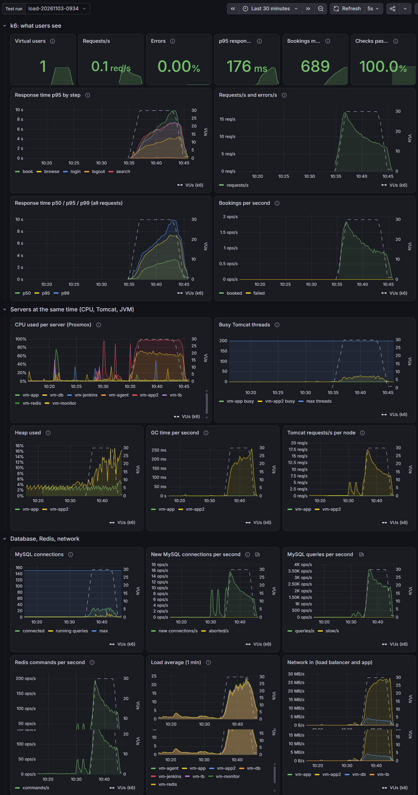
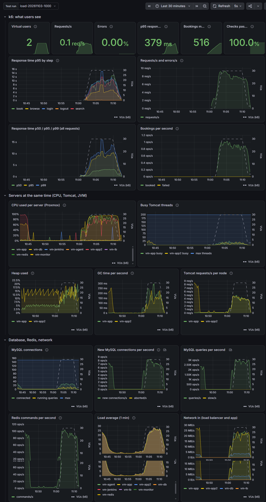

# Report: load test and scalability plan

## 1. Goal

Find out how many users TravelAgency can serve on the current servers, which part breaks first,
and what to change to serve more. Stage: "Monitor resource usage and plan for scalability".

## 2. Choices

| Need | Option | Plus | Minus |
|------|--------|------|-------|
| Load tool | **k6** ✅ | Test is JavaScript in Git, thresholds = pass/fail for CI, pushes to Prometheus | No browser (JS, images are not loaded) |
| | JMeter | GUI, many plugins | XML test files, heavy, hard to review in Git |
| | Locust | Python | Needs extra exporter for Prometheus |
| Results storage | **Prometheus remote write** ✅ | Same Prometheus and Grafana as the servers, one time axis | k6 output is still "experimental" |
| | InfluxDB | Classic k6 + Grafana setup | One more database to run |
| Percentiles | **Native histograms** ✅ | Correct p95 for any group of requests | Needs Prometheus 2.40+ (we have 3.x) |

## 3. Test

User journey (one iteration): log in → hotel list → search form → search free rooms for random dates
→ book a random room → booking page → my bookings → log out. Pause 1 s between pages.
Details and how to run: [README.md](README.md).

## 4. Found in the code before the test

These come from reading the code. The load test (section 5) shows how much they cost on the real servers.

| # | Problem | Where | Effect under load |
|---|---------|-------|-------------------|
| 1 | **No DB connection pool**: `DriverManagerDataSource` opens a new MySQL connection for every DB access | `HibernateConfig.dataSource()` | TCP + auth on every request: ~1 new MySQL connection per HTTP request |
| 2 | **N+1 queries**: `User.bookings` and `Booking.rooms` are `FetchType.EAGER`. Loading one user loads all bookings, all rooms of each booking, ... | `models/User.java`, `models/Booking.java` | ~230–300 SQL queries per HTTP request in the test; gets slower as bookings grow |
| 3 | **Search writes**: every search saves 2 empty bookings (`HotelServiceImpl.searchHotels` and `HotelController.searchHotels`) | search | Booking table grows on every search, makes #2 worse over time |
| 4 | `hibernate.show_sql: true` | `application.properties` | Every SQL query is written to the Tomcat log: CPU and disk |
| 5 | Room has one `booking_id`: a new booking overwrites the old one | `BookingServiceImpl.prepareBookingForDate` | Two users can book the same room for the same dates (not speed, but correctness) |
| 6 | Search shows only one room per class in each hotel (24 of 240) | `HotelServiceImpl.searchHotels` | All users fight for the same 24 rooms |
| 7 | Login checks the password with bcrypt | Spring Security | ~50–100 ms CPU per login; normal and intended |

## 5. Results

Grafana: dashboard **TravelAgency load test (k6)**, choose the run in **Test run**.
Servers: all LXC containers run on one Proxmox host.

| Run (`testid`) | Users | Nodes serving | Requests/s | p95 | Errors | Bookings | Passed? |
|----------------|-------|---------------|-----------|-----|--------|----------|---------|
| load-20261103-0934 | 30 | 1 (vm-app2 only) | ~16 at start → ~8 at end | up to ~6 s | 0% | 689 | ❌ p95 > 1.5 s |
| load-20261103-1000 | 30 | 2 (≈4.5 req/s each) | ~9 | ~8–10 s | 0% | 516 | ❌ p95 > 1.5 s |

### Finding 1: load balancing did not work

In the first run all traffic went to vm-app2, vm-app got 0 requests (panel "Tomcat requests/s per node"),
but users saw no errors. Cause: the nginx config on vm-lb was an old one with `ip_hash;`.
`ip_hash` uses only the first 3 parts of an IPv4 address, so every client from `192.168.18.x`
(including k6 on vm-agent) went to the same node. Sessions are in Redis now, so sticky sessions are not
needed. Fix: `ansible-playbook lb.yml` (the template has no `ip_hash`). Check: 20 requests through
nginx → 10 on each node (`tomcat_requestcount_total`).

### Finding 2: the bottleneck is the application code, not the number of nodes

| Signal | Run 1 | Run 2 |
|--------|-------|-------|
| CPU of app nodes | vm-app2 ~100% | both ~90–100% |
| GC time | ~0.25 s per second | 0.1–0.3 s per second on each node |
| MySQL queries per HTTP request | ~230 | ~300 |
| Data from DB per HTTP request | ~2 MB | ~2.8 MB |
| New MySQL connections per HTTP request | ~1 | ~1 |
| MySQL running queries | ~0 (DB is not busy) | ~0 |

- Requests/s fell while the number of users stayed the same (run 1: 16 → 8 req/s). Every iteration adds
  3 rows to `Booking` (2 from search + 1 booking), and `FetchType.EAGER` loads all bookings of the user
  with all their rooms on every page. More data → every request is more expensive (problems #2 and #3).
- Two nodes in run 2 gave about the same req/s as one node at the end of run 1: the data had grown,
  and all containers share the CPU of one Proxmox host.
- The database itself is not the limit: few connections, almost no running queries. The app nodes spend
  CPU on loading and garbage-collecting huge object graphs.

**Capacity now:** about 8–9 req/s (~30 users with 1 s think time) at p95 far above the goal.
Adding nodes on the same host will not help until steps 1–3 of the plan are done.

## 6. Scalability plan

Order: first cheap fixes in the code (they give the most), then more servers.

| Step | What | Why | Expected effect | Check with |
|------|------|-----|-----------------|------------|
| 1 | Connection pool **HikariCP** (`maximumPoolSize` ~10–20 per node) instead of `DriverManagerDataSource` | Problem #1 | Fewer DB connections, lower latency on every page | "New MySQL connections/s" drops to ~0 |
| 2 | `FetchType.LAZY` for `User.bookings`, `Booking.rooms`; `JOIN FETCH` only where a page needs it | Problem #2 | Tens of times fewer queries per page | MySQL queries/s per request/s |
| 3 | Search must not save bookings; create the booking only on "Book" | Problem #3 | No table growth from search | Booking row count after test |
| 4 | `hibernate.show_sql: false` in production | Problem #4 | Less CPU and log disk | CPU vm-app |
| 5 | Indexes on `Booking(start_date, end_date)`, booking table for room+dates instead of `Room.booking_id` | #5, #6, faster search | Correct bookings, faster availability query | p95 of search |
| 6 | Horizontal: add app nodes (vm-app3, ...) to `[app]` in inventory, run `app.yml`, `lb.yml` | Sessions are already in Redis, so any node can serve any user | ~linear growth while the DB is not the limit | Requests/s per node equal |
| 7 | Vertical for the DB: more CPU/RAM to vm-db, `innodb_buffer_pool_size` ~70% of RAM | After step 6 the DB becomes the limit | | CPU vm-db, running queries |
| 8 | Read replica for MySQL / cache for hotel list | If the DB is still the limit | | |
| 9 | Later: Kubernetes HPA (scale pods by CPU or by requests/s) | Plan stage "Orchestration via k8s" | Automatic scaling | |

After every step: run the same `stress` test and compare in Grafana (two `testid` side by side).

## 7. Alerts linked to the test

The Telegram alerts from the monitoring stage fire during the stress test. Expected: `HighCpu`
(> 80%), maybe `SiteSlow` (> 2 s) and `TomcatErrors`. This proves the alerts work under load.
Do not run stress tests during the day on shared servers.
