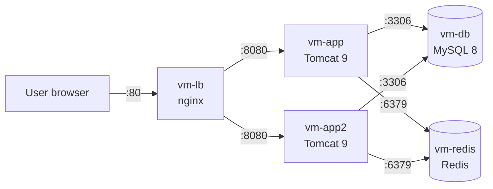
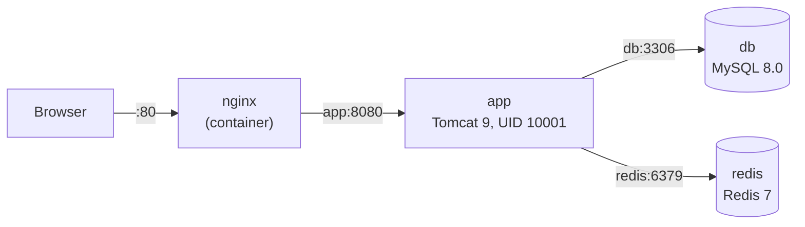
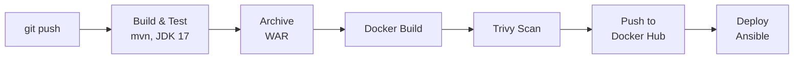

# Report: Travel Agency Load Balancing + Redis Sessions + Docker

## 1. Goal

Run the Travel Agency web app (Java, Spring MVC) on **two app nodes** behind an
**nginx load balancer**, so the site keeps working when one node goes down.

Two problems had to be solved for this:

- **Sessions.** The login session lived in Tomcat memory on one node. When a user
  moved to the other node, they were logged out. Now sessions are stored in **Redis**.
- **Database.** `hibernate.hbm2ddl.auto: create` + `insert.sql` dropped all
  tables and data on every start, and with two nodes this happened twice. Now
  the schema is managed by **Flyway** migrations.

Everything is set up with Ansible. No manual steps on the servers.

Then the app was **containerized**:

- **Docker image** with Tomcat 9 + JRE 17 that runs as a **non-root** user.
- **docker compose** with an **nginx reverse proxy** in front of the app, plus MySQL and Redis.
- Jenkins builds the image, scans it with **Trivy** and pushes it to **Docker Hub**.

---

## 2. Servers

All servers are Ubuntu 22.04 LXC containers on Proxmox.

| Server | CT ID | IP | CPU / RAM / Disk | What runs there |
|--------|-------|----|------------------|-----------------|
| vm-lb | 306 | 192.168.18.106 | 1 / 512 MB / 8 GB | nginx load balancer |
| vm-app | 301 | 192.168.18.101 | 1 / 2 GB / 8 GB | Tomcat 9, the app |
| vm-app2 | 305 | 192.168.18.105 | 1 / 2 GB / 8 GB | Tomcat 9, the app |
| vm-db | 302 | 192.168.18.102 | 1 / 2 GB / 8 GB | MySQL 8 |
| vm-redis | 307 | 192.168.18.107 | 1 / 512 MB / 8 GB | Redis (HTTP sessions) |

- The site (through the load balancer): `http://192.168.18.106/`
- Each node directly: `http://192.168.18.101:8080`, `http://192.168.18.105:8080`

---

## 3. How it works



1. The user opens `http://192.168.18.106/`.
2. nginx picks an app node from `upstream travelagency` and sends the request there.
3. Both nodes use the same MySQL database, so they show the same data.
4. Both nodes read and write sessions in the same Redis, so a login on one node
   is valid on the other node.
5. If a node does not answer, nginx sends the request to the other node. The user
   stays logged in, because the session is in Redis, not in the dead node.

On start, each app node runs Flyway first. Flyway applies only the migrations
that are not in the table `flyway_schema_history` yet. Then Hibernate starts and
only checks that the tables match the code (`hbm2ddl.auto: validate`).

### Docker stack



The same idea as on the VMs, on one host. Only nginx is published; the other
containers talk to each other by service name inside the compose network.

### CI/CD



Push and Deploy run only on the `load-balancing-redis` branch.

---

## 4. Design choices

### Load balancer

| Choice | Why |
|--------|-----|
| **nginx** as the load balancer | Simple, light (512 MB is enough), well known. |
| `max_fails=3 fail_timeout=10s` | A broken node is skipped for 10 seconds, then nginx tries it again. |
| `proxy_next_upstream error timeout http_502 http_503` | If a node fails, the same request is sent to the other node. The user does not see an error. |
| `X-Forwarded-*` headers | Tomcat knows the real client IP, not only the IP of nginx. |
| Server list built from the **`app` group** in the template | To add a node, add one line to `inventory.ini`. No change in the nginx config by hand. |
| Config check with **`nginx -t`** before reload | A broken config stops the playbook. nginx keeps the old working config. |
| **`force_handlers = True`** in `ansible.cfg` | Handlers (reload nginx, restart Redis) run even if a later task fails. |

### Redis sessions

| Choice | Why |
|--------|-----|
| **Spring Session Data Redis** | Replaces the Tomcat session with a Redis session without changes in controllers. |
| **Lettuce** client | The default client of Spring Data Redis, thread-safe, one connection for all requests. |
| `SessionInitializer` (session filter **before** Spring Security) | Spring Security keeps the login in the session, so it must read the Redis session, not the Tomcat one. |
| `mybookings` in `Security.java` is **`transient`** | Objects in a Redis session are serialized. A lazy Hibernate collection must not be stored there. |
| Session timeout **30 minutes** | Same as the Tomcat default. Old sessions are deleted by Redis. |
| Redis `bind 127.0.0.1 <LAN IP>` | App nodes need the network address; the outside world does not. |
| Redis **`requirepass`** | Without a password anyone in the network can read all sessions. |
| Passwords in a systemd drop-in with mode **`0600`** | Only root can read the file with the DB and Redis passwords. |

### Flyway migrations

| Choice | Why |
|--------|-----|
| **Flyway** instead of `hbm2ddl.auto: create` | Each SQL file runs only once. Data stays after a deploy or a restart. |
| `hbm2ddl.auto: validate` | Hibernate does not change the schema; it only stops the app if the schema is wrong. |
| `V1__create_schema.sql`, `V2__seed_data.sql` | Schema and test data are separate versions. The old `insert.sql` became `V2`. |
| Flyway bean runs **before** Hibernate (`@DependsOn("flyway")`) | Hibernate checks the tables only after they are created. |
| Safe for two nodes | Flyway takes a database lock, so two nodes that start at the same time do not apply the same migration twice. |

### Docker image

| Choice | Why |
|--------|-----|
| **Multi-stage** build (Maven → Tomcat) | The final image has no Maven, no sources and no JDK: smaller and fewer CVEs. |
| Build on **JDK 17** (`maven:3.9-eclipse-temurin-17`) | Lombok 1.18.20 in `pom.xml` fails on JDK 21. |
| Run on **`tomcat:9.0-jre17-temurin-jammy`** | Same Tomcat 9 + Java 17 as on the VMs; the OS tag is pinned. |
| `pom.xml` copied before `src` | The dependency layer is cached; a code change does not download everything again. |
| WAR as **`ROOT.war`** | The site opens on `/`, the same as the Ansible deploy. |
| **Non-root** user `app`, **`USER 10001`** (number) | A break-in into Tomcat does not give root in the container. A numeric UID lets Kubernetes `runAsNonRoot` check it. |
| Write access only to `logs`, `temp`, `work`, `webapps` | `conf` and `bin` stay owned by root, so the app cannot change its own config. |
| `.dockerignore` | `.git`, `target`, `ansible` and `.env` never go into the build context or the image. |

### docker compose + nginx

| Choice | Why |
|--------|-----|
| **nginx** in front of Tomcat | Same pattern as `vm-lb`; Tomcat is not exposed directly. |
| Only nginx has **`ports`**, the app has only `expose` | Tomcat, MySQL and Redis are not reachable from outside the host. |
| `upstream` on **`app:8080`** | Docker DNS resolves the service name; no IP addresses in the config. |
| `server_tokens off`, `/nginx-health` | The nginx version is hidden; a simple health URL for checks. |
| **Healthchecks** + `depends_on: service_healthy` | The app starts only when MySQL and Redis are ready, so Flyway and Redis do not fail on start. |
| Secrets from **`.env`** with `${VAR:?}` | Passwords are not in Git; compose stops if a password is missing. |
| Named volume **`db-data`** | Data stays after `docker compose down` / `up`. |
| `HTTP_PORT` variable | Easy to move to another port if 80 is busy on the host. |

### Docker Hub + Trivy in Jenkins

| Choice | Why |
|--------|-----|
| Tags **`<build number>`** and **`latest`** | Every build is a separate version; `latest` points to the newest one. |
| Trivy as a **container** (`aquasec/trivy:0.57.1`) | Nothing to install on the agent; the version is pinned. |
| `HIGH,CRITICAL`, `--ignore-unfixed` | Shows only problems that matter and have a fix. |
| **Report-only** (`--exit-code 0`), report archived | Old libraries in `pom.xml` have known CVEs; a hard gate would stop every build. For a gate: `--severity CRITICAL --exit-code 1`. |
| Trivy DB cache in `$HOME/.cache/trivy` | The vulnerability DB is not downloaded on every build. |
| `dockerhub-creds` + **access token** + `--password-stdin` | The token is not in Git, not in the log and can be revoked without changing the account password. |
| Push only on `load-balancing-redis` | Feature branches do not overwrite `latest`. |

---

## 5. Files

| File | What changed |
|------|--------------|
| `ansible/redis.yml` | New. Installs Redis, sets `bind` and `requirepass`, restarts Redis only on change. |
| `ansible/inventory.ini` | New group `redis` with `vm-redis`. |
| `ansible/provision.yml` | New container 307 (`vm-redis`). |
| `ansible/group_vars/all.yml` | New vars `redis_host`, `redis_port`, `redis_password` (from env). |
| `ansible/.env.example` | New secret `REDIS_PASSWORD` (example value). |
| `ansible/app.yml` | Stops early if `REDIS_PASSWORD` is empty. |
| `ansible/travelagency.conf.j2` | New env vars `REDIS_TRAVELAGENCY_HOST`, `_PORT`, `_PASSWORD` for Tomcat. |
| `ansible/lb.yml`, `ansible/nginx-lb.conf.j2` | nginx load balancer (from the `load-balancing` branch). |
| `pom.xml` | New dependencies: `flyway-core`, `flyway-mysql`, `spring-session-data-redis`, `lettuce-core`. |
| `RedisSessionConfig.java` | New. Connection to Redis, `@EnableRedisHttpSession`. |
| `SessionInitializer.java` | New. Adds the session filter before Spring Security. |
| `WebAppInitializer.java` | Loads `RedisSessionConfig`. |
| `Security.java` | `mybookings` is `transient`. |
| `HibernateConfig.java` | Flyway bean; old `DataSourceInitializer` with `insert.sql` removed. |
| `application.properties` | `hbm2ddl.auto: validate`, new `redis.*` settings. |
| `db/migration/V1__create_schema.sql` | New. Creates the tables. |
| `db/migration/V2__seed_data.sql` | Test data, moved from `insert.sql`. |
| `Dockerfile` | New. Multi-stage build, Tomcat 9 + JRE 17, non-root user `app` (UID 10001). |
| `.dockerignore` | New. Keeps `.git`, `target`, `ansible`, `.env` out of the build. |
| `docker-compose.yml` | New. Services `nginx`, `app`, `db`, `redis` with healthchecks. |
| `nginx/nginx.conf` | New. Reverse proxy to `app:8080`. |
| `.env.example` | New. Example secrets for compose. |
| `Jenkinsfile` | New stages: Docker Build, Trivy Scan, Push to Docker Hub. |

---

## 6. Run order

```bash
cd ansible
set -a; source .env; set +a
ansible-playbook provision.yml
ansible-playbook redis.yml
ansible-playbook app.yml
ansible-playbook lb.yml
```

`redis.yml` must run before `app.yml`: the app connects to Redis when it starts.

Docker (one host):

```bash
cp .env.example .env            # put real passwords into .env
docker compose up -d --build
```

Push the image by hand:

```bash
docker login -u nazariybu       # password = Docker Hub access token
docker build -t nazariybu/travelagency:1.0.0 .
docker tag nazariybu/travelagency:1.0.0 nazariybu/travelagency:latest
docker push nazariybu/travelagency:1.0.0
docker push nazariybu/travelagency:latest
```

---

## 7. Tool versions

| Tool | Version |
|------|---------|
| Ubuntu (containers) | 22.04 |
| nginx | 1.18.0 |
| Tomcat | 9 |
| Java | OpenJDK 17 |
| MySQL | 8 |
| Redis | 6 (Ubuntu 22.04 package) |
| Flyway | 9.22.3 |
| Spring Session Data Redis | 2.5.2 |
| Lettuce | 6.1.4 |
| Docker Engine + Compose plugin | from `download.docker.com` (Compose v2) |
| Build / run images | `maven:3.9-eclipse-temurin-17` / `tomcat:9.0-jre17-temurin-jammy` |
| Compose images | `nginx:1.27-alpine`, `mysql:8.0`, `redis:7-alpine` |
| Trivy | 0.57.1 |

---

## 8. How to check

1. `curl -I http://192.168.18.106/` returns `200` or `302`, not the nginx welcome page.
2. `tail -f /var/log/tomcat9/localhost_access_log.*.txt` on both nodes shows which node answers.
3. Log in on the site. On `vm-redis`, `redis-cli -a "$REDIS_PASSWORD" --no-auth-warning keys 'spring:session:*'` shows the session keys.
4. `systemctl stop tomcat9` on the node that serves you: the site still works through the other node, and **the user is still logged in**.
5. `systemctl start tomcat9`: the node is back in the pool.
6. Add some data on the site, run `ansible-playbook app.yml` again or restart Tomcat: **the data is still there**.
7. On `vm-db`: `mysql travelagency -e "SELECT version, description, success FROM flyway_schema_history;"` shows `1` and `2`, both `success = 1`.
8. A second run of `redis.yml`, `app.yml` and `lb.yml` shows `changed=0` (idempotency).
9. `docker compose ps`: `db` and `redis` are `(healthy)`, only `nginx` has `0.0.0.0:80`, `app` has only `8080/tcp`.
10. `curl -I http://localhost/form-login` returns `HTTP/1.1 200` with `Server: nginx` (no version).
11. `docker compose exec app id` shows `uid=10001(app)`: Tomcat does not run as root.
12. After opening the site, `spring:session:*` keys appear in the `redis` container.
13. Jenkins: all stages are green, `trivy-report.txt` is in the build artifacts, and Docker Hub shows the tags `<build number>` and `latest`.

---

## 9. Known limits

- One Redis and one MySQL server: each is still a single point of failure.
- Redis traffic is not encrypted (no TLS). This is fine only inside the local network.
- Trivy only reports and does not stop the build. The libraries in `pom.xml` (Spring 5.3.9, logback 1.2.3, mysql-connector 8.0.x, jetty 9.4) are old and have known CVEs.
- The compose stack has one app container. Scaling (`--scale app=2`) works with Redis sessions, but nginx uses Docker DNS and is not a full load balancer like `vm-lb`.
- `docker build` in Jenkins builds the WAR a second time inside the image (Stage 1).
---

## 10. Status

| Step | Status |
|------|--------|
| Containers `vm-app2`, `vm-lb` | ✅ Done |
| nginx load balancer | ✅ Done |
| App deployed on `vm-app` and `vm-app2` | ✅ Done |
| Failover test | ✅ Done |
| Flyway migrations instead of `hbm2ddl create` | ✅ Done |
| Container `vm-redis`, Redis with password | ✅ Done |
| Sessions in Redis (login stays after node stop) | ✅ Done  |
| Data stays after redeploy | ✅ Done  |
| Idempotency (`changed=0`) | ✅ Done |
| Docker image, non-root (UID 10001) | ✅ Done |
| docker compose with nginx reverse proxy | ✅ Done |
| Trivy scan stage in Jenkins | ✅ Done |
| Image push to Docker Hub from Jenkins | ✅ Done |
