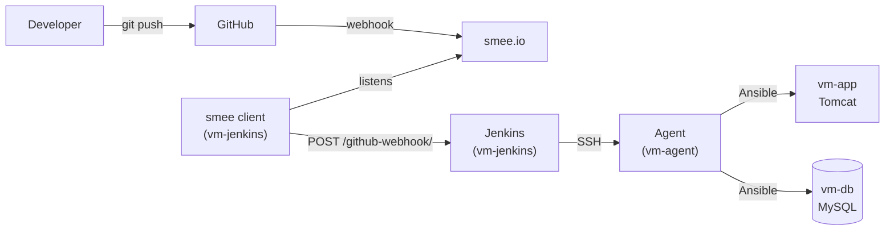

# Report: Travel Agency CI/CD with Jenkins

## 1. Goal

Build a CI/CD pipeline for the Travel Agency web app (Java, Spring MVC).
After every `git push`, Jenkins must build and test the code, save the WAR file,
and deploy it to the servers with Ansible. No manual steps.

This work is based on the Ansible setup from the `ansible` branch
(`provision.yml` creates the containers, `app.yml` installs MySQL and the app).

---

## 2. Servers

All servers are Ubuntu 22.04 LXC containers on Proxmox (`192.168.18.200`).

| Server | CT ID | IP | CPU / RAM / Disk | What runs there |
|--------|-------|----|------------------|-----------------|
| vm-jenkins | 303 | 192.168.18.103 | 1 / 2 GB / 16 GB | Docker, Jenkins controller, smee client |
| vm-agent | 304 | 192.168.18.104 | 4 / 4 GB / 32 GB | Docker, Java 17, Ansible |
| vm-app | 301 | 192.168.18.101 | 1 / 2 GB / 8 GB | Tomcat 9, the app |
| vm-db | 302 | 192.168.18.102 | 1 / 2 GB / 8 GB | MySQL |

- Jenkins: `http://192.168.18.103:8080`
- The app: `http://192.168.18.101:8080`

---

## 3. How it works

1. A developer pushes code to GitHub.
2. GitHub sends a webhook to smee.io.
3. The smee client on `vm-jenkins` gets it and passes it to Jenkins.
4. Jenkins sends the job to `vm-agent` (the controller does not build anything).
5. The agent runs the pipeline from the `Jenkinsfile`.

---

## 4. Design choices

| Choice | Why |
|--------|-----|
| Jenkins controller **in Docker** | Easy to update and back up. All data is in one volume (`jenkins_home`). |
| **Separate agent**, controller has 0 executors | Builds do not slow down or break Jenkins itself. |
| Agent connects **over SSH** | Simple, no extra open ports on the agent. |
| Build steps run **in a Maven Docker container** | Clean and the same build every time. No Maven install on the agent. |
| WAR is built **once** in Jenkins, Ansible only copies it | The server gets the exact file that passed the tests. |
| `app.yml` still works **without Jenkins** | Without `war_file` it clones and builds on `vm-app` as before. |
| **smee.io** for webhooks | Servers have private IPs. smee needs no domain, no open ports, Jenkins stays closed to the internet. |
| **Multibranch Pipeline** | Jenkins finds branches with a `Jenkinsfile` by itself. Deploy runs only for one branch. |
| Everything set up **with Ansible** (`jenkins.yml`) | The setup can be repeated on new containers. |

---

## 5. The pipeline

| Stage | Where | What it does |
|-------|-------|--------------|
| Build & Test | Maven Docker container on vm-agent | `mvn clean package`: builds the code and runs the tests. Maven cache is kept in `/home/jenkins/.m2`. |
| Archive | vm-agent | Saves `TravelAgency.war` in Jenkins. |
| Deploy | vm-agent | `ansible-playbook app.yml -e war_file=...`. Only for the `jenkins` branch. |

---

## 6. Files

| File | What changed |
|------|--------------|
| `Jenkinsfile` | New. The pipeline. |
| `ansible/jenkins.yml` | New. Installs Docker, Jenkins, smee client; prepares the agent; gives the agent SSH access to app and db. |
| `ansible/provision.yml` | Two new containers (303, 304) with `nesting=1` for Docker. CPU, RAM and disk per container. |
| `ansible/inventory.ini` | New groups `jenkins` and `jenkins_agent`. |
| `ansible/app.yml` | New option `war_file`: copy a ready WAR instead of building on the server. |
| `ansible/group_vars/all.yml` | Jenkins settings: image, port, agent user, smee URL. |
| `ansible/requirements.yml` | New collections `community.docker`, `ansible.posix`. |
| `README.md` | Step-by-step guide for the Jenkins setup. |

---

## 7. Security

| What | How |
|------|-----|
| DB password | Jenkins Credentials (`db-password`, Secret text). Hidden in the logs. |
| GitHub token | Jenkins Credentials (`github-token`). |
| Agent SSH key | Separate key `~/.ssh/jenkins_agent`, only for the `jenkins` user on the agent. |
| Deploy access | The agent has its own SSH key. It is added only to `vm-app` and `vm-db`. |
| Jenkins from the internet | Closed. Webhooks come in through an outgoing smee connection. |
| Secrets in Git | None. `.env` is in `.gitignore`. |

---

## 8. Problems and fixes

| # | Problem | Cause | Fix |
|---|---------|-------|-----|
| 1 | `gnupg ... do not seem to be installed` | The minimal LXC template has no `gnupg`, the Ansible PPA cannot be added. | Install `ansible-core` on the agent with pip. No PPA. |
| 2 | `keyserver receive failed` | The Ubuntu keyserver did not answer. | Same fix: pip instead of the PPA. |
| 3 | Agent: `PEM problem: it is of unknown type` | The private key was pasted into Jenkins wrong. | Pasted the full key again (all 7 lines). |
| 4 | `'Jenkinsfile' not found` | The file had a space at the end of its name and was not pushed. | Renamed to `Jenkinsfile`, committed and pushed. |
| 5 | `anonymous access`, Jenkins sleeps 5 min | No GitHub token, limit of 60 API requests per hour. | Added a GitHub token as `Username with password`. |
| 6 | Maven cannot write to `/root/.m2` | In Docker, Maven runs as the `jenkins` user, not root. | Cache moved to `/home/jenkins/.m2`. |
| 7 | WAR built twice (in Jenkins and on vm-app) | `app.yml` always cloned and built the code. | Added the `war_file` option to `app.yml`. |
| 8 | smee gets the push, Jenkins does nothing (`405`) | smee-client 5 removes the last `/`, Jenkins redirects, the POST becomes GET. | Pinned `smee-client@2`. |

---

## 9. Tool versions

| Tool | Version |
|------|---------|
| Ubuntu (containers) | 22.04 |
| Jenkins | 2.541.3 LTS (`jenkins/jenkins:lts-jdk17`) |
| Docker | 29.1.3 |
| ansible-core on the agent | 2.17.14 (pip) |
| Java on the agent | OpenJDK 17 |
| Maven image | `maven:3.9-eclipse-temurin-17` |
| smee-client | 2.x |
| Jenkins plugins | Suggested + SSH Build Agents, Docker Pipeline, GitHub Branch Source |

---

## 10. How to check

1. Push a change to the `jenkins` branch.
2. The smee channel page shows a `push` event.
3. `ssh root@192.168.18.103 docker logs --tail 5 smee` shows `POST ... - 200`.
4. Jenkins starts a build of the `jenkins` branch by itself.
5. All stages are green, `TravelAgency.war` is in the build artifacts.
6. `http://192.168.18.101:8080` shows the new version.

---

## 11. Status

| Step | Status |
|------|--------|
| Containers `vm-jenkins`, `vm-agent` | ✅ Done |
| Jenkins in Docker | ✅ Done |
| Agent connected over SSH | ✅ Done |
| Pipeline: build, test, archive, deploy | ✅ Done |
| Multibranch job with GitHub token | ✅ Done |
| GitHub webhook through smee.io | ✅ Done |
| Recreate `vm-app` / `vm-db` from the pipeline (Provision stage) | ⏳ Planned |

---

## 12. Next steps

1. **Provision stage**: run `provision.yml` from Jenkins, so deleted `vm-app` / `vm-db` are created again.
2. **Code checks**: SonarQube stage in the pipeline.
3. **Artifact storage**: push the WAR to Nexus.
4. **Docker image** of the app, built in the pipeline.
5. Change `hibernate.hbm2ddl.auto` from `create` to `update`, so the data is not lost after each deploy.
