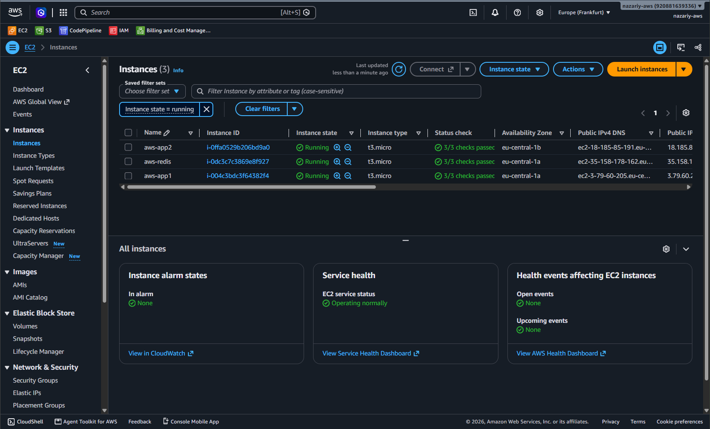
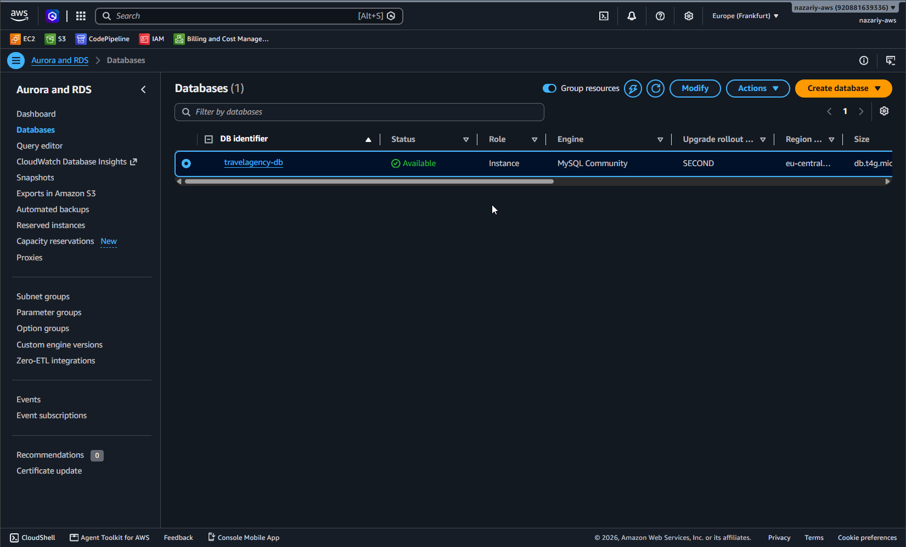
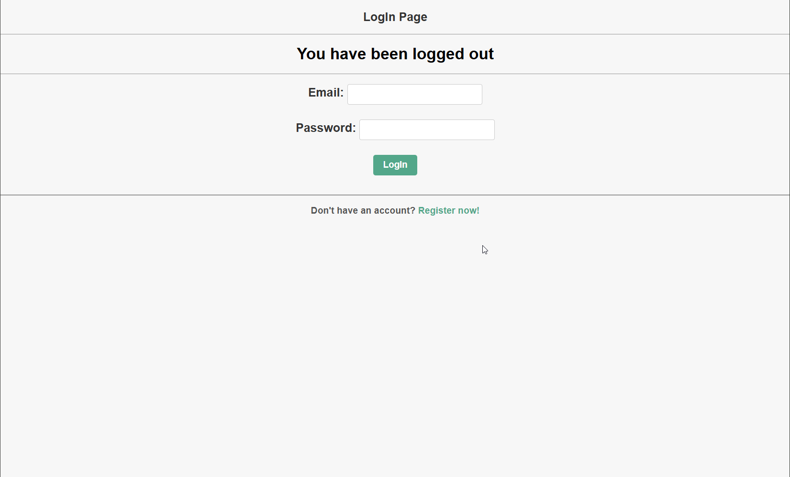

# REPORT: Migrate an application to the cloud (AWS)

## 1. Goal

Run TravelAgency in a public cloud, created with Terraform and configured with the existing Ansible
playbooks: two app nodes behind a load balancer, Redis for sessions, a managed MySQL database with the data
from the home server. Keep the cost at (almost) zero: Free Tier sizes, a budget alert, and
`terraform destroy` after the demo.

## 2. Migration strategy

The "6 R" of cloud migration: rehost, replatform, refactor, repurchase, retire, retain.

| Part | Strategy | Why |
|------|----------|-----|
| App nodes (Tomcat 9 + WAR) | **Rehost** (lift and shift) to EC2 | Same OS (Ubuntu 22.04), same `app.yml`. No code change |
| Redis (sessions) | **Rehost** to EC2 | ElastiCache with a password needs TLS (in-transit encryption); the app connects without TLS. A code change = refactor, not this stage |
| nginx load balancer | **Replatform** to ALB | Managed, 2 zones, health checks, public DNS name. Nothing to install or patch |
| MySQL | **Replatform** to RDS | Managed: backups, minor updates, no SSH, no public address. Data with `mysqldump` |
| Vault, Jenkins, Prometheus/Grafana/Loki | **Retain** (stay at home) | Not needed for the app to run; would double the cost |
| Containers / Kubernetes | **Refactor**: next stage | ECS/EKS = bigger change, Kubernetes stage |

## 3. Choices

| Question | Chosen | Why | Not chosen |
|----------|--------|-----|------------|
| Cloud | AWS, eu-central-1 (Frankfurt) | Most used, Free Tier + credits for new accounts, close to Ukraine | Azure, GCP (also fine; one cloud for the whole project) |
| Terraform layout | new module `modules/aws-ec2` + new folder `envs/aws`, shared inventory template | Planned in the IaC stage: the platform code is in one module, every env has its own state | Copying envs/proxmox and changing everything |
| Module inputs | same names as `proxmox-lxc`: `name`, `ip`, `disk`, `ssh_public_key`, `tags` (+ `swap`) | Both envs read the same way | `cores`/`memory`: in AWS you pick an `instance_type` instead |
| App/Redis servers | EC2 `t3.micro`, Ubuntu 22.04 (newest official Canonical AMI) | Free Tier; 22.04 has the `tomcat9` package (24.04 only `tomcat10`) | t3.small (2 GB, faster Maven build, not Free Tier for old accounts) |
| 1 GB RAM | 2 GB swap file via cloud-init on app nodes | Maven + Tomcat do not fit in 1 GB | Building the WAR elsewhere (`-e war_file=`), also possible |
| SSH user | `ubuntu` + `become` (cloud-init puts the key) | EC2 Ubuntu does not allow root SSH; no EC2 key pair resource needed | Allow root login (worse) |
| Network | own VPC, 2 public subnets + 2 private DB subnets, **no NAT gateway** | NAT costs ~35 USD/month; security groups limit access | Private app subnets + NAT (better isolation, costs money) |
| Who can reach it | SSH and HTTP only from the home public IP (found by `data "http"`, checkip.amazonaws.com); `site_open_to_world = true` for a public demo | No open SSH to the internet, IP is not written in Git | Fixed IP in tfvars (would be in a public repo) |
| Load balancer | ALB, HTTP :80, health check `/form-login`, round-robin, no stickiness | Sessions are in Redis, so any node can serve any user | Classic/Network LB; nginx on EC2 (rehost) |
| HTTPS | **not yet** | ACM certificate needs a domain name; we have none | Self-signed certificate (browser warning) |
| Database | RDS MySQL **8.4**, `db.t4g.micro`, 20 GB gp2, single-AZ, not public, encrypted | Free Tier; 8.0 is in paid Extended Support since 2026-07-31 | MySQL 8.0 (extra cost), Multi-AZ (2x price), Aurora (not Free Tier) |
| Extended Support | `engine_lifecycle_support = open-source-rds-extended-support-disabled` | Never pay for an old engine by mistake | default (auto-enrolled, paid) |
| DB password | the same `db_password` from Vault, `password_wo` (write-only) | Not in the state; one password for RDS and Tomcat | `password` (saved in the state in plain text), `manage_master_user_password` (Secrets Manager, 0.40 USD/month, second secret store) |
| AWS credentials | IAM user `terraform-travelagency` (EC2 + RDS full access), access key in Vault `secret/travelagency/aws`, read as `ephemeral` | No root keys; not in the state or in files | AWS CLI profile in `~/.aws/credentials` (plain text file); Vault AWS secrets engine (dynamic keys, better, needs root token setup) |
| State | local file per env, not in Git | One person, one machine; the S3 backend cannot read its keys from the Vault provider (backend starts before providers) | S3 backend (next step) |
| Budget | AWS Budgets in the console, 10 USD/month, **credits not included** | Exists before any resource and even if Terraform breaks; with credits included the spend looks like 0 and no alert comes | Budget in Terraform (would be destroyed with `terraform destroy` or never created if apply fails) |
| Data migration | `mysqldump` → gzip → scp to aws-app1 → `mysql` into RDS, once | Small DB, simple, shows the real steps | AWS DMS (for big DBs / no downtime, not needed) |

## 4. Cost estimate

eu-central-1, on-demand prices, rounded (check in the AWS Pricing Calculator, prices change):

| Resource | Count | ~USD per hour | ~USD per 30 days |
|----------|-------|---------------|------------------|
| EC2 t3.micro | 3 | 0.036 | 26 |
| EBS gp3 | 28 GB | 0.004 | 2.7 |
| Public IPv4 (3 servers + 2 for the ALB) | 5 | 0.025 | 18 |
| ALB (hour + minimal LCU) | 1 | 0.035 | 25 |
| RDS db.t4g.micro | 1 | 0.019 | 14 |
| RDS storage gp2 | 20 GB | 0.004 | 2.7 |
| **Total without Free Tier** | | **~0.12** | **~89** |

- This account is older than 12 months: no Free Tier, no credits, everything is paid.
  Plan: create, check and destroy in one session of ~4–5 hours = ~0.5–1 USD.
- New accounts get credits (100 USD at sign-up, up to 100 USD more for activities), a short demo is then free.
- Older accounts (before 2025-07-15) in their first 12 months: 750 h/month EC2 t3.micro, RDS db.t4g.micro,
  ALB and public IPv4 are free, ~30 USD/month left with 3 servers running all month.
- Biggest hidden costs avoided: NAT gateway (~35 USD/month), MySQL 8.0 Extended Support
  (~0.10 USD per vCPU-hour = ~146 USD/month for 2 vCPU), forgotten resources (budget + destroy + tag check).

## 5. Security notes

- No secret in Git, `*.tf`, `terraform.tfstate` or plan files: AWS keys and the DB password are `ephemeral` / write-only.
- RDS: no public address, port 3306 only from the app security group. Redis: 6379 only from the app security group.
- SSH only from the home IP, key only, user `ubuntu`. IMDSv2 required on all servers. EBS and RDS encrypted.
- HTTP only (no domain for a certificate): the login password goes in plain text between browser and ALB.
  That is why the site is open only to the home IP by default.
- The IAM user has full EC2 and RDS rights: more than needed. Better: a policy with only the used actions,
  or short-lived keys from the Vault AWS secrets engine.
- The JDBC URL has `useSSL=false` (inside the VPC). Better: TLS to RDS with the RDS CA bundle.

## 6. Results

Run on 2026-11-04. Account older than 12 months: no Free Tier, no credits, everything paid.
Terraform `<terraform version>`, provider hashicorp/aws `<version from .terraform.lock.hcl>`.

| Check | Expected | Result |
|-------|----------|--------|
| Budget created before any resource | `travelagency-monthly`, 10 USD, 3 alerts (10 %, 50 % actual, 100 % forecasted) | OK (credits filter not needed: the account has no credits) |
| AWS key in Vault | `secret/travelagency/aws`: `access_key_id`, `secret_access_key` (40 characters) | OK |
| `terraform plan` in envs/proxmox after the template change | `No changes.` | OK |
| `ansible-playbook redis.yml --check` at home | `changed=0` | OK |
| First `terraform plan` (envs/aws) | `Plan: 24 to add, 0 to change, 0 to destroy.` | OK |
| `terraform apply` | `Apply complete! Resources: 24 added` | OK |
| `ansible -i inventory-aws.ini all -m ping` | 3 × `pong` | OK |
| Data migrated | same number of rows in `User` / `Booking` at home and in RDS | OK |
| `app.yml` on AWS | `failed=0` on aws-app1, aws-app2 | OK |
| ALB target group | 2 × `healthy` | OK |
| Site via `site_url` | login page, login works, hotels visible | OK |
| Both nodes answer | ~10 / 10 of 20 test requests in the Tomcat logs | OK |
| One node down (`systemctl stop tomcat9` on aws-app1) | site still works, target `unhealthy` | OK |
| Secrets not in the state | `grep -c` → `0` | OK |
| `terraform destroy` | `Resources: 24 destroyed.` | `<OK>` |
| Nothing left | Tag Editor `Project = travelagency` → no resources | `<OK>` |

### Screenshots

Two EC2 app nodes:

RDS MySQL:

Site through the load balancer:

## 7. Next

- Kubernetes stage: EKS or containers in ECS with the image from ECR (refactor).
