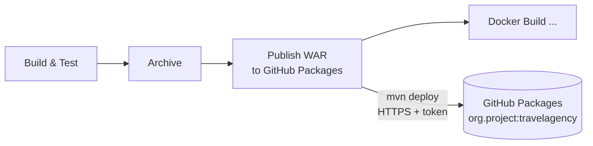

# Report: Travel Agency WAR in GitHub Packages

## 1. Goal

Store the built WAR in a real **artifact repository**, not only in the Jenkins
build artifacts. Every build must have its own version that can be downloaded
later, even if Jenkins is reinstalled.

**GitHub Packages** (Maven registry) was chosen instead of Nexus or JFrog.

---

## 2. Why GitHub Packages

| Option | Plus | Minus |
|--------|------|-------|
| **GitHub Packages** ✅ | No extra server; the package is next to the code; login is a GitHub token | Download needs a token even for a public repo; classic token only |
| Nexus OSS | Full control, proxy for Maven Central | One more container with 2–4 GB RAM, disk and backups |
| JFrog Artifactory | Many formats, rich UI | Heavy; the free version is limited |

For one app and a home lab, an extra server for artifacts is not worth it.

---

## 3. How it works

1. The stage `Publish WAR to GitHub Packages` runs in `maven:3.9-eclipse-temurin-17`.
2. `withCredentials` gives the login and token from the Jenkins credential
   `github-packages` as env vars `GH_PKG_USER` and `GH_PKG_TOKEN`.
3. `versions:set` sets the version `1.0.<build number>`.
4. `mvn deploy` reads the URL from `pom.xml` and the login from
   `ci/maven-settings.xml` (linked by the id `github`) and uploads the WAR and the POM.

---

## 4. Design choices

| Choice | Why |
|--------|-----|
| `distributionManagement` in `pom.xml`, id **`github`** | `mvn deploy` knows where to upload; the id links it to the login in settings. |
| `ci/maven-settings.xml` with **`${env.GH_PKG_USER}` / `${env.GH_PKG_TOKEN}`** | The file is in Git, the secret is not. Jenkins gives the values at run time. |
| Jenkins credential **`github-packages`** + `withCredentials` | The token is in the Jenkins store, available only inside this stage and masked in the log. |
| **Classic** token with `write:packages` | The GitHub Maven registry does not accept fine-grained tokens. |
| Version **`1.0.<build number>`** via `versions:set` | A release version cannot be uploaded twice (`409`). The version matches the Docker tag of the same build. |
| `artifactId` **`travelagency`** (lower case) | GitHub Packages returned `422 Unprocessable Entity` for `TravelAgency`. `<finalName>` keeps the file name `TravelAgency.war`, so the Dockerfile and Ansible do not change. |
| `-DskipTests` in the deploy stage | Tests already ran in `Build & Test`. |
| Same Maven image and `.m2` cache as `Build & Test` | Same JDK 17; dependencies are not downloaded again. |
| Publish only on the **`github-packages`** branch | Other branches do not create package versions. |

---

## 5. Files

| File | What changed |
|------|--------------|
| `pom.xml` | New `distributionManagement` (GitHub Packages URL); `artifactId` changed to `travelagency`. |
| `ci/maven-settings.xml` | New. Login for the server `github` from env vars. |
| `Jenkinsfile` | New stage `Publish WAR to GitHub Packages`. |

---

## 6. Problems and fixes

| Problem | Cause | Fix |
|---------|-------|-----|
| `curl ... \| grep -i x-oauth-scopes` showed only `access-control-expose-headers` | The grep found the word inside another header | `grep -iE '^(HTTP\|x-oauth-scopes)'` |
| `422 Unprocessable Entity` on the first `mvn deploy` | Upper case letters in `artifactId` (`TravelAgency`) | `artifactId` → `travelagency` |

---

## 7. How to check

1. `curl -sI -u $GH_PKG_USER:$GH_PKG_TOKEN https://api.github.com/user` shows `HTTP/2 200` and `x-oauth-scopes` with `write:packages`.
2. Manual `mvn -s ci/maven-settings.xml deploy -DskipTests` ends with `BUILD SUCCESS`.
3. Jenkins: the stage `Publish WAR to GitHub Packages` is green; the log shows `Uploaded to github: .../travelagency/1.0.<N>/travelagency-1.0.<N>.war` and the token as `****`.
4. GitHub → repo → **Packages** → `org.project.travelagency` has version `1.0.<N>`.
5. `curl -fL -u ... .../travelagency-1.0.<N>.war` downloads the WAR; `unzip -l` shows `WEB-INF/`.
6. The next build adds `1.0.<N+1>` with no `409`.

---

## 8. Known limits

- The token is a personal classic token: it has a time limit (90 days) and must be renewed in Jenkins; the `repo` scope gives access to all repos of the account.
- Download from the GitHub Maven registry needs a token even for a public repo, so Ansible still deploys the WAR from the Jenkins workspace, not from GitHub Packages.
- `mvn deploy` packages the WAR once more after `Build & Test`.
- Old versions are not deleted automatically; they can be removed in the package settings on GitHub.

---

## 9. Status

| Step | Status |
|------|--------|
| Classic token with `write:packages` | ✅ Done |
| `distributionManagement` + `ci/maven-settings.xml` | ✅ Done |
| Manual `mvn deploy` to GitHub Packages | ✅ Done |
| Jenkins credential `github-packages` | ✅ Done |
| Stage `Publish WAR to GitHub Packages` green in Jenkins | ✅ Done |
