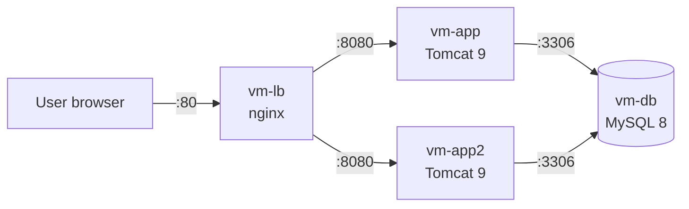

# Report: Travel Agency nginx Load Balancing

## 1. Goal

Run the Travel Agency web app (Java, Spring MVC) on **two app nodes** behind an
**nginx load balancer**. If one node goes down, the site must keep working.
Everything is set up with Ansible. No manual steps on the servers.

---

## 2. Servers

All servers are Ubuntu 22.04 LXC containers on Proxmox 

| Server | CT ID | IP | CPU / RAM / Disk | What runs there |
|--------|-------|----|------------------|-----------------|
| vm-lb | 306 | 192.168.18.106 | 1 / 512 MB / 8 GB | nginx load balancer |
| vm-app | 301 | 192.168.18.101 | 1 / 2 GB / 8 GB | Tomcat 9, the app |
| vm-app2 | 305 | 192.168.18.105 | 1 / 2 GB / 8 GB | Tomcat 9, the app |
| vm-db | 302 | 192.168.18.102 | 1 / 2 GB / 8 GB | MySQL 8 |

- The site (through the load balancer): `http://192.168.18.106/`
- Each node directly: `http://192.168.18.101:8080`, `http://192.168.18.105:8080`

---

## 3. How it works

1. The user opens `http://192.168.18.106/`.
2. nginx picks an app node from `upstream travelagency` and sends the request there.
3. Both nodes use the same MySQL database, so they show the same data.
4. If a node does not answer, nginx sends the request to the other node.

---

## 4. Design choices

| Choice | Why |
|--------|-----|
| **nginx** as the load balancer | Simple, light (512 MB is enough), well known. |
| **`ip_hash`** (sticky sessions) | The login session lives in Tomcat memory. One client must always go to the same node, or the user is logged out. |
| `max_fails=3 fail_timeout=10s` | A broken node is skipped for 10 seconds, then nginx tries it again. |
| `proxy_next_upstream error timeout http_502 http_503` | If a node fails, the same request is sent to the other node. The user does not see an error. |
| `X-Forwarded-*` headers | Tomcat knows the real client IP, not only the IP of nginx. |
| Server list built from the **`app` group** in the template | To add a node, add one line to `inventory.ini`. No change in the nginx config by hand. |
| Config check with **`nginx -t`** before reload | A broken config stops the playbook. nginx keeps the old working config. |
| **`force_handlers = True`** in `ansible.cfg` | Handlers (reload nginx) run even if a later task fails. |

---

## 5. Files

| File | What changed |
|------|--------------|
| `ansible/lb.yml` | New. Installs nginx, removes the default site, adds the load balancer config, checks it with `nginx -t`. |
| `ansible/nginx-lb.conf.j2` | New. nginx config: `upstream` with `ip_hash` and the list of app nodes. |
| `ansible/inventory.ini` | New host `vm-app2` in the `app` group, new group `lb`. Groups `jenkins` and `jenkins_agent` removed. |
| `ansible/provision.yml` | New containers 305 (`vm-app2`) and 306 (`vm-lb`). Containers 303, 304 removed. |
| `ansible/ansible.cfg` | `force_handlers = True`. |
| `README.md` | Guide for the load balancer setup. |

`app.yml` did not change: its play runs on every host in the `app` group, so it
deploys to both nodes.

---

## 6. Tool versions

| Tool | Version |
|------|---------|
| Ubuntu (containers) | 22.04 |
| nginx | 1.18.0 |
| Tomcat | 9 |
| Java | OpenJDK 17 |
| MySQL | 8 |

---

## 7. How to check

1. `curl -I http://192.168.18.106/` returns `200` or `302`, not the nginx welcome page.
2. `tail -f /var/log/tomcat9/localhost_access_log.*.txt` on both nodes shows which node answers.
3. Log in on the site, click around: the user stays logged in (sticky sessions).
4. `systemctl stop tomcat9` on `vm-app`: the site still works through `vm-app2`.
5. `systemctl start tomcat9` on `vm-app`: the node is back in the pool.
6. A second run of `ansible-playbook lb.yml` shows `changed=0` (idempotency).

---

## 8. Status

| Step | Status |
|------|--------|
| Containers `vm-app2`, `vm-lb` | ✅ Done |
| nginx load balancer with `ip_hash` | ✅ Done |
| App deployed on `vm-app2` | ✅ Done |
| App deployed on `vm-app` | ✅ Done |
| Failover test | ✅ Done |
| Jenkins files removed | ✅ Done |

