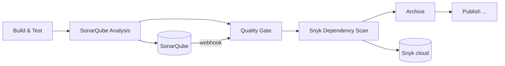

# Report: SonarQube and Snyk in the Jenkins pipeline

## 1. Goal

Add two checks to the pipeline **before** anything is published:

- **static code analysis** of our Java code with a quality gate that can stop the pipeline;
- **SCA** (software composition analysis): known vulnerabilities in Maven dependencies.

Trivy already scans the Docker image. It sees the OS and the files in the image,
but it does not judge our code and reports dependencies only after the image is built.

---

## 2. Choices

| Need | Option | Plus | Minus |
|------|--------|------|-------|
| Code quality | **SonarQube Community, self-hosted** ✅ | Free, runs in the home lab, Jenkins plugin with quality gate | 2–3 GB RAM, needs `vm.max_map_count`; one branch per project |
| | SonarCloud | No server | Needs a public repo for the free plan |
| Dependencies | **Snyk** ✅ | Good vulnerability DB, fix advice, web UI with monitoring | Cloud account, 200 tests/month on the free plan |
| | OWASP Dependency-Check | Fully local, free | Slow first run (NVD download), more false positives |

---

## 3. How it works

1. `SonarQube Analysis`: `withSonarQubeEnv('sonarqube')` + `mvn ... sonar-maven-plugin:5.1.0.4751:sonar`
   in the same Maven image and `.m2` cache as the build.
2. `Quality Gate`: `waitForQualityGate abortPipeline: true` inside `timeout(5 min)`;
   SonarQube sends the result to `http://<jenkins>:8080/sonarqube-webhook/`.
3. `Snyk Dependency Scan`: `snyk test --file=pom.xml --severity-threshold=high` in
   `snyk/snyk:maven-3-jdk-17`; exit code decides the build result.

---

## 4. Design choices

| Choice | Why |
|--------|-----|
| SonarQube in Docker Compose with **PostgreSQL** | The embedded DB is only for tests and does not survive upgrades. |
| `vm.max_map_count` set on the **Proxmox host** | LXC shares the host kernel; `sysctl -w` inside an unprivileged LXC does not work. |
| Image pinned to `26.9.0.129388-community` | A known version; `community` alone would upgrade on every pull. |
| Plugin called by full name `sonar-maven-plugin:5.1.0.4751:sonar` | No change in `pom.xml`; the version is fixed. |
| URL and token only in Jenkins (`withSonarQubeEnv`) | No address or secret in the Jenkinsfile. |
| Quality gate via **webhook**, not polling | Jenkins just waits; SonarQube reports when processing ends. |
| Quality gate **blocks** the pipeline | Code that fails the gate is not published or deployed. |
| Snyk vulnerabilities → **UNSTABLE**, not FAILED | The current dependencies are old, so every build would fail. Same soft mode as Trivy. Change `unstable(...)` to `error(...)` after the update. |
| Snyk error (exit 2/3) → FAILED | A broken scan must not look like a clean one. |
| Snyk CLI from the Docker image, no Jenkins plugin | Nothing to install in Jenkins; same pattern as Trivy. |
| `--entrypoint=` and `HOME = WORKSPACE` | Jenkins controls the container; the CLI needs a writable home for its config. |
| `snyk monitor` only on `load-balancing-redis` | The Snyk UI tracks the main branch and emails on new CVEs; other branches do not spend the test limit. |

---

## 5. Files

| File | What changed |
|------|--------------|
| `Jenkinsfile` | New stages `SonarQube Analysis`, `Quality Gate`, `Snyk Dependency Scan` after `Build & Test`. |
| `sonarqube/docker-compose.yml` | New. SonarQube + PostgreSQL. |
| `pom.xml` | 9 duplicate dependency declarations removed. |
| `ci/dedupe-pom.py` | New. Script that removed them. |

---

## 6. Problems and fixes

| Problem | Cause | Fix |
|---------|-------|-----|
| Snyk: `SNYK-OS-MAVEN-0018 Cannot build Maven dependency tree` | `pom.xml` declared `mysql-connector-java` 4 times, `javax.servlet-api` 3 times, `hibernate-core`, `spring-tx`, `spring-orm`, `jakarta.persistence-api` twice. Maven 3.9 only warns; the Maven in the Snyk image stops with `must be unique`. | `ci/dedupe-pom.py` keeps the last declaration of each (the one Maven 3.9 used). `mvn dependency:list` before and after shows no difference. |

---

## 7. How to check

1. `curl -s http://<sonarqube-ip>:9000/api/system/status` → `"status":"UP"`.
2. `curl -s -u "$SONAR_TOKEN:" .../api/authentication/validate` → `{"valid":true}`.
3. Jenkins build page: **SonarQube Quality Gate → TravelAgency: Passed**, server-side processing **Success**.
4. SonarQube → Webhooks → `jenkins`: green **Last delivery**.
5. Artifact `snyk-report.txt` lists the tested dependencies and the HIGH/CRITICAL issues.
6. Build result is UNSTABLE while vulnerable dependencies remain.

---

## 8. Known limits

- SonarQube Community analyses one branch per project: all branches write to `travelagency`.
- No tests and no JaCoCo, so coverage is 0%; the gate conditions on coverage do not mean much yet.
- Snyk free plan: 200 open source tests per month.
- Tokens expire (SonarQube 90 days) and must be renewed in Jenkins.
- Snyk findings do not block the pipeline yet.

---

## 9. Status

| Step | Status |
|------|--------|
| `vm.max_map_count` on Proxmox, SonarQube + PostgreSQL running | ✅ Done |
| SonarQube token, webhook, Jenkins server `sonarqube` | ✅ Done |
| Snyk account, Jenkins credential `snyk-token` | ✅ Done |
| Duplicate dependencies removed from `pom.xml` | ✅ Done |
| Branch `sonar-snyk`, build #1: Quality Gate **Passed**, `snyk-report.txt` archived, build UNSTABLE | ✅ Done |

