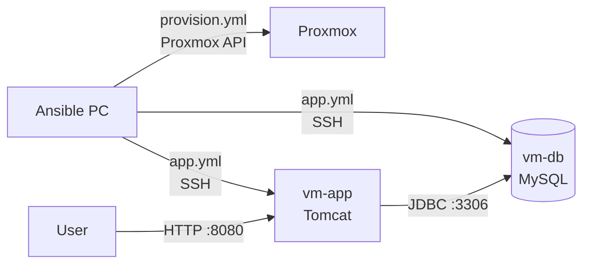

# Project Report: Travel Agency Deploy with Ansible

## 1. Goal

Deploy the Travel Agency web app (Java, Spring MVC) on two servers in Proxmox.
All steps are done with Ansible, so the setup is the same every time.

| Server | Type | IP | What runs there |
|--------|------|----|-----------------|
| vm-app | LXC container 301 | 192.168.18.101 | Java 17, Maven, Tomcat 9, the app |
| vm-db  | LXC container 302 | 192.168.18.102 | MySQL |

Proxmox host: `192.168.18.200`. The app is open at `http://192.168.18.101:8080`.

---

## 2. How it works



1. **`provision.yml`** – creates and starts two Ubuntu 22.04 containers in Proxmox.
2. **`app.yml`** has 3 parts:
   - **Check** – stops if the database password is not loaded.
   - **vm-db** – installs MySQL, opens it for the local network, creates the database and the user.
   - **vm-app** – installs Java, Maven, Tomcat and Git, downloads the code from GitHub,
     builds the WAR file, gives Tomcat the database settings, and starts the app.
     At the end it checks that the login page answers (`/form-login`).

---

## 3. Files

| File | What it does |
|------|--------------|
| `ansible.cfg` | Main settings (inventory file, no SSH host key check). |
| `inventory.ini` | Servers and their IP addresses. |
| `requirements.yml` | Extra collections: `community.mysql`, `community.proxmox`. |
| `provision.yml` | Creates and starts the containers. |
| `app.yml` | Sets up MySQL and the app. |
| `group_vars/all.yml` | Settings: database name, user, Git repo, paths. |
| `travelagency.conf.j2` | Template: database address, user and password for Tomcat. |
| `.env` / `.env.example` | Secrets (DB password, Proxmox token). `.env` is not in Git. |

---

## 4. Security

- Passwords and tokens are kept in `.env`, not in Git (`.gitignore`).
- Ansible reads them from environment variables.
- The DB password is hidden in the output (`no_log: true`).
- The Tomcat settings file with the password has mode `0600`.
- MySQL user can connect only from `192.168.18.%`.

---

## 5. Problems and fixes

| # | Problem | Cause | Fix |
|---|---------|-------|-----|
| 1 | `ansible-galaxy` – "read operation timed out" | Ansible 2.10 from Ubuntu apt is too old for the new Galaxy API | Removed it, installed new Ansible from the official PPA |
| 2 | `ansible --version` – "unsupported locale setting" | New Ansible needs a UTF-8 locale, system had `LANG=C` | Made `en_US.UTF-8` and set it as default |
| 3 | "Requires proxmoxer 2.3 or newer; found 1.2.0" | apt has only old `python3-proxmoxer` | Removed apt package, installed `proxmoxer>=2.3` with `pip3` |
| 4 | "Start container" failed with `'name'` | Proxmox was still creating the containers | Added retries (`until`, `retries: 10`, `delay: 5`) |

---

## 6. Tool versions

| Tool | Version |
|------|---------|
| Ubuntu (Ansible PC and containers) | 22.04 |
| Python | 3.10 |
| ansible-core | 2.15 or newer (from PPA) |
| community.mysql | 3.11.0 |
| community.proxmox | 2.1.0 |
| proxmoxer | 2.3 or newer |
| Java | 17 |
| Tomcat | 9 |

---

## 7. How to run

```bash
cd ~/travelagency/ansible
ansible-galaxy collection install -r requirements.yml
set -a; source .env; set +a
ansible-playbook provision.yml
ansible all -m ping
ansible-playbook app.yml
```

Then open `http://192.168.18.101:8080`.

---

## 8. Status

| Step | Status |
|------|--------|
| Tools installed | Done |
| Collections installed | Done |
| Containers created and started (`provision.yml`) | Done |
| App deployed (`app.yml`) | Done |

