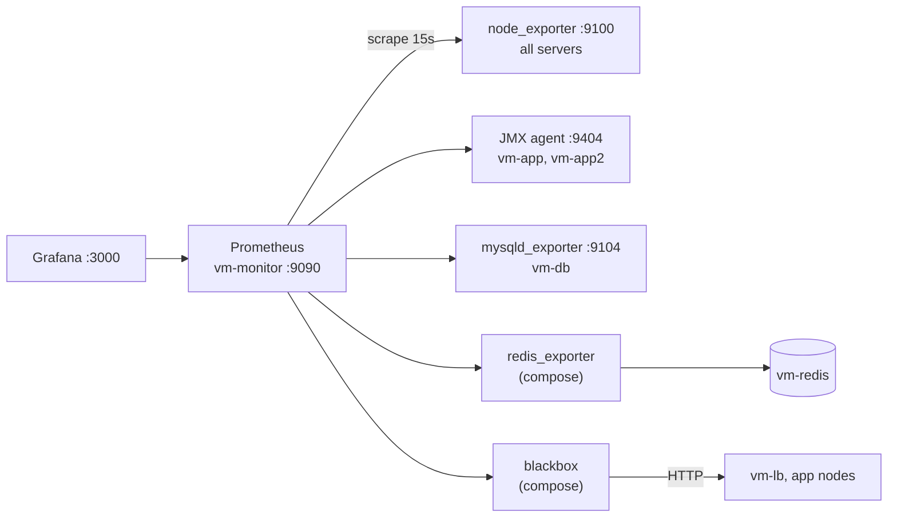
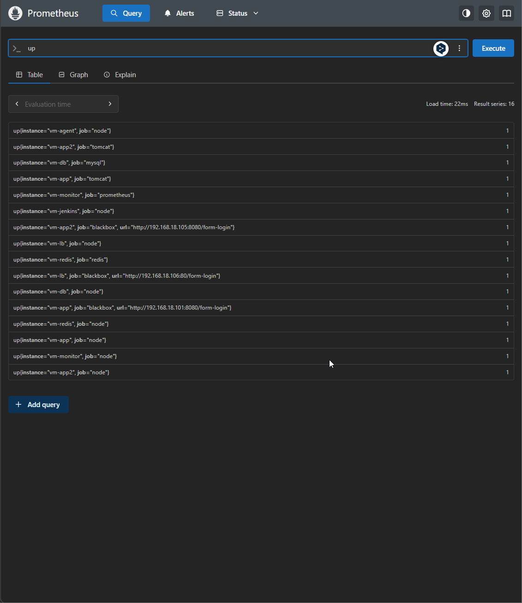
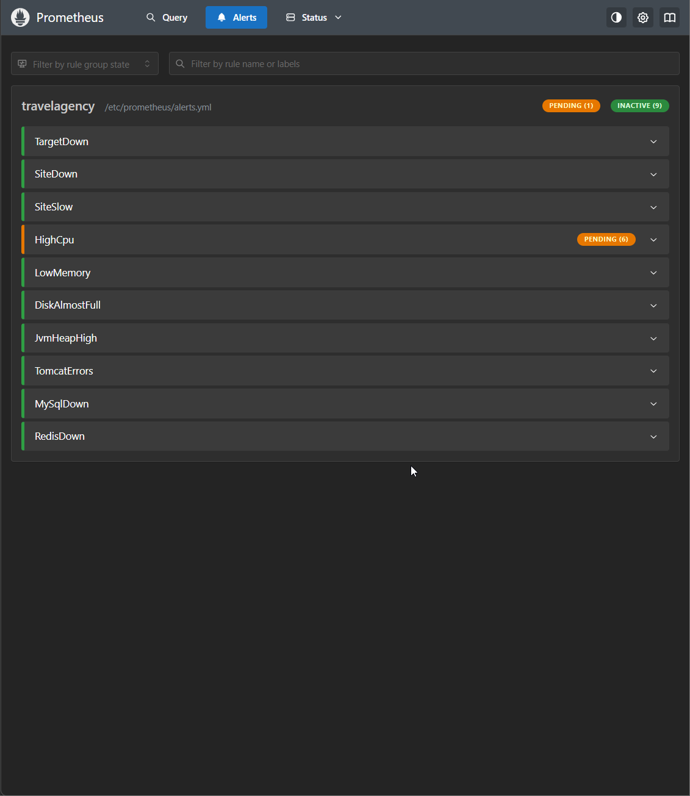
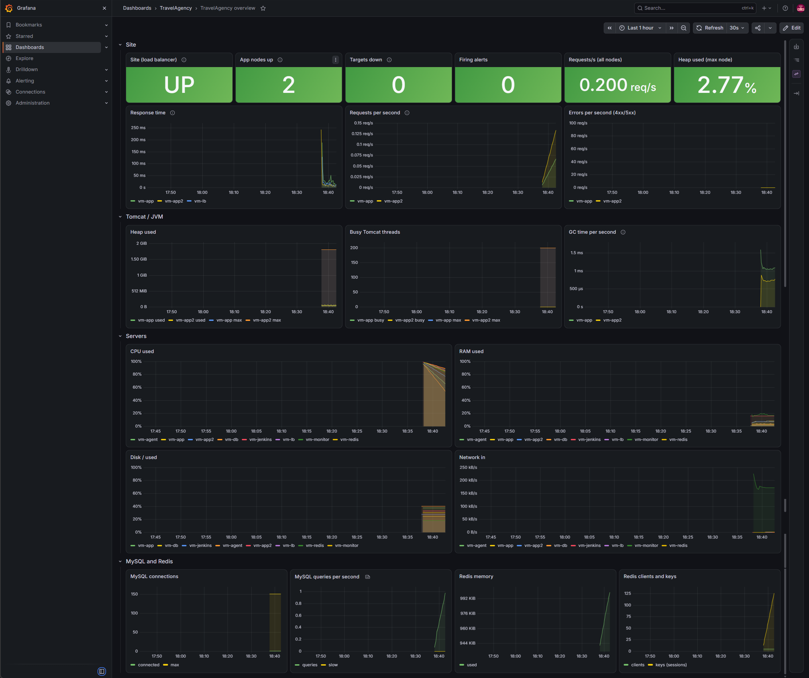

# Report: monitoring with Prometheus and Grafana

## 1. Goal

See the health of the application and the infrastructure in one place:

- **infrastructure:** CPU, RAM, disk and network of every server;
- **application:** is the site up, how fast it answers, requests and errors per node,
  JVM heap and garbage collection, busy Tomcat threads;
- **data stores:** MySQL connections and queries, Redis memory and sessions;
- **alerts** when something is down or close to a limit.

---

## 2. Choices

| Need | Option | Plus | Minus |
|------|--------|------|-------|
| Metrics DB | **Prometheus** ✅ | Standard, pull model, PromQL, many exporters | Not for logs or long-term storage |
| | Zabbix | Agent + UI in one | Heavier, less common with Docker/k8s |
| Dashboards | **Grafana** ✅ | Provisioning from files, community dashboards | One more service |
| JVM / Tomcat metrics | **JMX exporter as `-javaagent`** ✅ | No code change; JVM + Tomcat MBeans | Tomcat restart once |
| | Micrometer in the app | Custom business metrics | Code change; this is not Spring Boot (no Actuator) |
| Where to run Prometheus + Grafana | **New LXC `vm-monitor`, Docker Compose** ✅ | Separate from the app; one-file setup; pinned versions | One more container (2 GB RAM) |
| | On `vm-jenkins` | No new server | Monitoring would die together with Jenkins |

---

## 3. How it works

---

## 4. Design choices

| Choice | Why |
|--------|-----|
| Targets generated from `inventory.ini` | One source of truth: a new node in `[app]` is monitored after one playbook run. |
| `instance` label = host name (`vm-app`), not IP | Readable legends and alerts. |
| node_exporter and mysqld_exporter from Ubuntu packages | systemd service and user `prometheus` come with the package; `apt` updates them. |
| JMX agent in a **separate** systemd drop-in (`monitoring.conf`) | `app.yml` keeps owning `travelagency.conf`; the two playbooks do not overwrite each other. |
| `CATALINA_OPTS` instead of editing `/etc/default/tomcat9` | No change to a package file; `catalina.sh run` reads it from the environment. |
| `serial: 1` for the app nodes | Tomcat restarts one node at a time, the load balancer keeps the site up. |
| MySQL user `prometheus` with **auth_socket** | The exporter runs as Linux user `prometheus` and needs no password at all. Rights: `PROCESS, REPLICATION CLIENT, SELECT`. |
| redis_exporter and Blackbox in the compose stack | They only need network access, so nothing is installed on `vm-redis` or `vm-lb`. |
| Blackbox checks `/form-login` on the LB **and** on each node | The LB check is what users see; node checks show which node is down. |
| Grafana data source and dashboard by **provisioning** | Rebuilding `vm-monitor` gives the same Grafana; the dashboard is in Git. |
| Secrets (`GRAFANA_ADMIN_PASSWORD`, `REDIS_PASSWORD`) only in `.env` | Same as the other playbooks; on the server `.env` is `0600`, Ansible uses `no_log`. |
| Images pinned to exact versions | A `docker compose pull` never upgrades by surprise. |
| Alert rules without Alertmanager (for now) | Rules are visible in Prometheus; sending to Telegram is the next step. |

---

## 5. Alert rules

| Alert | Condition | For |
|------|-----------|-----|
| `TargetDown` | an exporter does not answer (`up == 0`) | 1m |
| `SiteDown` | Blackbox check failed | 1m |
| `SiteSlow` | response time > 2 s | 5m |
| `HighCpu` | CPU > 80% | 5m |
| `LowMemory` | free RAM < 10% | 5m |
| `DiskAlmostFull` | disk `/` > 85% | 10m |
| `JvmHeapHigh` | heap > 90% of max | 5m |
| `TomcatErrors` | > 0.1 responses 4xx/5xx per second | 5m |
| `MySqlDown` | `mysql_up == 0` | 1m |
| `RedisDown` | `redis_up == 0` | 1m |

---

## 6. How to check

1. `http://192.168.18.108:9090/targets`: all targets are **UP**.
2. Grafana → **TravelAgency overview**: every panel has data.
3. Open the site a few times: **Requests per second** grows on both nodes (round-robin).
4. `systemctl stop tomcat9` on `vm-app2`: after ~1 min `TargetDown` and `SiteDown` (for `vm-app2`)
   are **firing**, **App nodes up** = 1, **Site (load balancer)** stays **UP**.
5. `systemctl start tomcat9`: the alerts go back to **inactive**.
6. A second run of `monitoring.yml`: Tomcat is not restarted.

### Screenshots

All 16 targets are UP (`up` query): node_exporter on 8 servers, Tomcat on 2 nodes,
MySQL, Redis, Blackbox for the load balancer and both nodes, Prometheus itself.

All 10 alert rules are loaded from `/etc/prometheus/alerts.yml`.

Grafana dashboard **TravelAgency overview**: site UP, both nodes up, 0 targets down,
requests on both nodes (round-robin), JVM heap, server resources, MySQL and Redis.

---

## 7. Known limits

- LXC containers share the Proxmox kernel. CPU and RAM come through lxcfs and show the
  container limits, but some values (load average, disk I/O) are for the whole host.
- No Alertmanager yet: alerts are only visible in the Prometheus UI.
- No logs yet (Loki is the next step), no container metrics (cAdvisor): the app runs in Tomcat, not in Docker.
- Prometheus and Grafana have no TLS; Prometheus has no login. This is fine only inside the local network.
- One Prometheus: if `vm-monitor` is down, there is no monitoring (and no alert about it).

---

## 8. Status

| Step | Status |
|------|--------|
| Container `vm-monitor` (CT 309) | ✅ Done |
| node_exporter on all servers | ✅ Done |
| JMX exporter in Tomcat on both nodes | ✅ Done |
| mysqld_exporter on `vm-db` | ✅ Done |
| Prometheus + Grafana + Blackbox + redis_exporter | ✅ Done |
| All targets UP | ✅ Done |
| Dashboard with data | ✅ Done |
| Alert test (stop one node) | ⬜ |
